<div align="center">

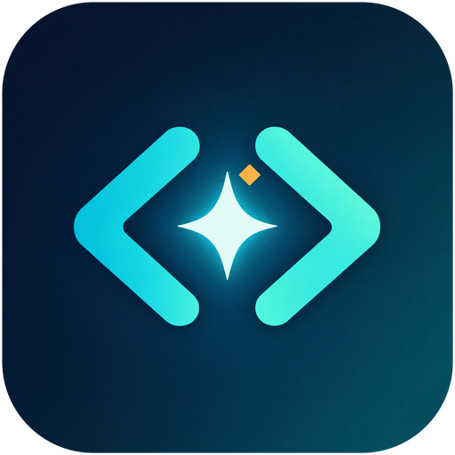

# PerplexiCode Kilo

**A Kilo Code-style autonomous coding agent for Antigravity IDE and VS Code, powered by your Perplexity Pro / Max subscription.**

Plan, write, run and debug code with GPT-6.1 Sol, Claude Opus 5.5, Gemini 4 Argon, Grok 4.7 and 85 more Perplexity models. No API keys.

[](https://github.com/MRX7999/PerplexiCode-Kilo/releases/latest)
[](https://open-vsx.org/extension/MRX7999/perplexicode-kilo)
[](https://open-vsx.org/extension/MRX7999/perplexicode-kilo)
[](https://github.com/MRX7999/PerplexiCode-Kilo/actions/workflows/ci.yml)
[](https://github.com/MRX7999/PerplexiCode-Kilo/releases)
[](https://code.visualstudio.com/)
[](https://antigravity.google/download)
[](LICENSE)

[Install](#install) · [Features](#features) · [Models](#models) · [Modes](#modes) · [Commands](#commands-and-shortcuts) · [Settings](#settings) · [Build](#build-from-source) · [FAQ](#troubleshooting)

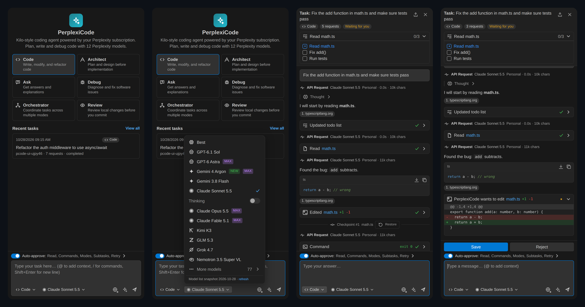

</div>

---

## Install

Extension ID: **`MRX7999.perplexicode-kilo`**

### From the Extensions view (Open VSX)

Antigravity IDE, Cursor, Windsurf and VSCodium use [Open VSX](https://open-vsx.org/extension/MRX7999/perplexicode-kilo). Open the Extensions view (`Cmd/Ctrl+Shift+X`), search for **PerplexiCode Kilo** and click **Install**, or run:

```bash
antigravity-ide --install-extension MRX7999.perplexicode-kilo
```

### One-line install from GitHub Releases

**macOS / Linux** — installs the latest release into Antigravity IDE:

```bash
curl -fsSL https://raw.githubusercontent.com/MRX7999/PerplexiCode-Kilo/master/scripts/install.sh | bash
```

**Windows (PowerShell):**

```powershell
irm https://raw.githubusercontent.com/MRX7999/PerplexiCode-Kilo/master/scripts/install.ps1 | iex
```

Other editors: add `--ide code`, `--ide cursor`, `--ide windsurf` or `--ide all` (PowerShell: `-Ide code`):

```bash
curl -fsSL https://raw.githubusercontent.com/MRX7999/PerplexiCode-Kilo/master/scripts/install.sh | bash -s -- --ide all
```

The scripts download [`perplexicode-kilo.vsix`](https://github.com/MRX7999/PerplexiCode-Kilo/releases/latest/download/perplexicode-kilo.vsix) from the [latest release](https://github.com/MRX7999/PerplexiCode-Kilo/releases/latest), find the editor CLI on your `PATH` or inside the app bundle, install with `--force` and print the installed version. Read them first: [install.sh](scripts/install.sh), [install.ps1](scripts/install.ps1).

### Manual install with the Antigravity CLI

Download [`perplexicode-kilo.vsix`](https://github.com/MRX7999/PerplexiCode-Kilo/releases/latest/download/perplexicode-kilo.vsix), then:

```bash
# macOS — Antigravity IDE
"/Applications/Antigravity IDE.app/Contents/Resources/app/bin/antigravity-ide" \
  --install-extension ~/Downloads/perplexicode-kilo.vsix --force

# Windows — Antigravity IDE
"%LOCALAPPDATA%\Programs\Antigravity IDE\bin\antigravity-ide.cmd" --install-extension "%USERPROFILE%\Downloads\perplexicode-kilo.vsix" --force

# VS Code / Cursor / Windsurf
code --install-extension perplexicode-kilo.vsix --force
```

The CLI may print `antigravityAnalytics ... NOT registered` — that line is harmless.

### Install from the editor UI

Extensions view (`Cmd/Ctrl+Shift+X`) → `…` menu → **Install from VSIX…** → pick the downloaded file.

### After installing

1. Reload the window: `Cmd/Ctrl+Shift+P` → **Developer: Reload Window**.
2. Open the **PerplexiCode** icon in the activity bar.
3. Sign in (see below) and start a task.

### Moving from PerplexiCode 1.x / 2.0

Since 2.1.0 the extension has its own ID, `MRX7999.perplexicode-kilo` (it was `perplexicode.perplexicode`). Editors keep each extension's secrets separate, so accounts are moved once, with your confirmation:

1. Install PerplexiCode Kilo next to the old extension and reload the window.
2. Click **Import accounts** in the notification. A small bundled helper ([source](bridge/extension.js)) takes over the old ID — it has no UI and makes no network requests.
3. Reload again and confirm **Copy accounts** in the dialog. Sessions, CSRF tokens, cookies and the rotation strategy are copied locally; duplicates are skipped.
4. Click **Uninstall old extension**.

User settings `perplexicode.*` are copied to `perplexicodeKilo.*` automatically. You can rerun the import with **PerplexiCode: Import Accounts from PerplexiCode 1.x**.

### Sign in

Run **PerplexiCode: Add Perplexity Account** and pick one method:

| Method | How it works |
| --- | --- |
| **Import from Browser** (recommended) | Reads your existing `perplexity.ai` session from Chrome, Edge or Brave. |
| **Auto Login** | Opens a browser window, you log in, the session is captured. |
| **Manual Paste** | Paste the full `Cookie` header from DevTools → Network on [perplexity.ai](https://www.perplexity.ai). |

Sessions are kept in the editor's [SecretStorage](https://code.visualstudio.com/api/references/vscode-api#SecretStorage). You can add several accounts; requests are spread across them with **round-robin**, **least-used** or **failover-only** rotation.

---

## Features

| | |
| --- | --- |
| **Agent loop** | The model works step by step with tools, sees each result and continues until the task is done — the way [Kilo Code](https://github.com/Kilo-Org/kilocode) works. |
| **Six modes** | Code, Architect, Ask, Debug, Orchestrator and Review, each with its own prompt and tool permissions. |
| **Diff approvals** | Every edit is shown as an inline diff with **Save** / **Reject**; commands get **Run** / **Reject**. |
| **Auto-approve** | Separate toggles for reads, writes, commands (allow and deny prefixes), mode switches, subtasks, todo updates and retries, plus a request limit. |
| **Checkpoints** | A checkpoint after every edit with one-click **Restore**. |
| **Context mentions** | `@/path/to/file`, `@/folder/`, `@problems`, `@git-changes`, `@selection`. |
| **Editor actions** | Explain / Fix / Improve / Add to Context from the context menu and lightbulb quick fixes; terminal selection to context. |
| **Workspace rules** | Loads `AGENTS.md`, `.kilocode/rules`, `.roo/rules`, `.clinerules` and `~/.kilocode/rules`. |
| **Task UI** | Todo list with progress, streaming Markdown, reasoning blocks, tool cards, terminal output, follow-up suggestions, prompt enhancer. |
| **History** | Searchable task history; reopen, delete or export past tasks. |
| **Commit messages** | Generates a commit message from staged changes in the Source Control view. |
| **Multi-account** | Several Perplexity accounts with quota display and automatic failover. |

### Screenshots

<table>
  <tr>
    <td align="center">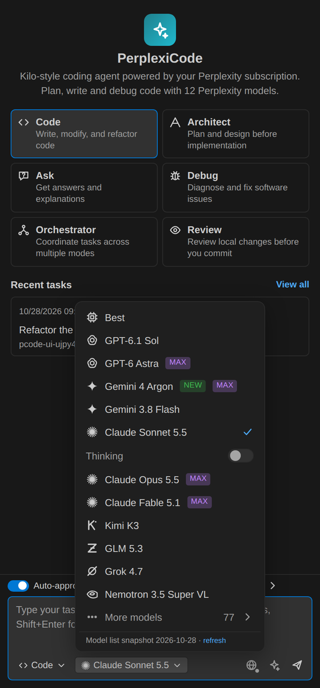<br /><sub>Model picker with Max badges and Thinking toggle</sub></td>
    <td align="center">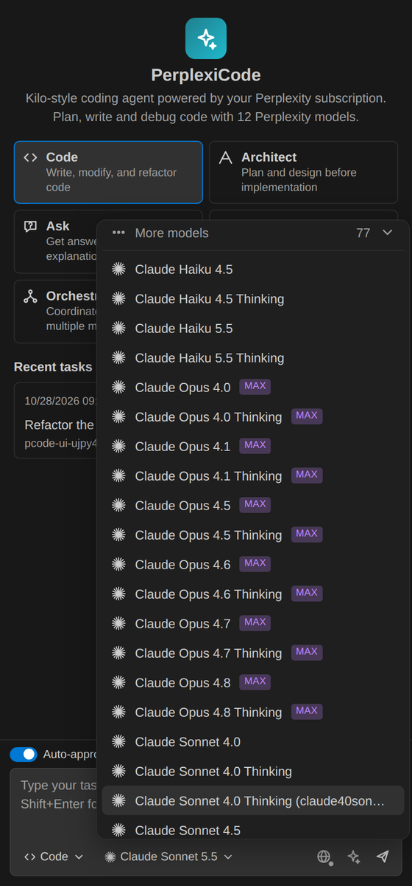<br /><sub>77 more models</sub></td>
    <td align="center">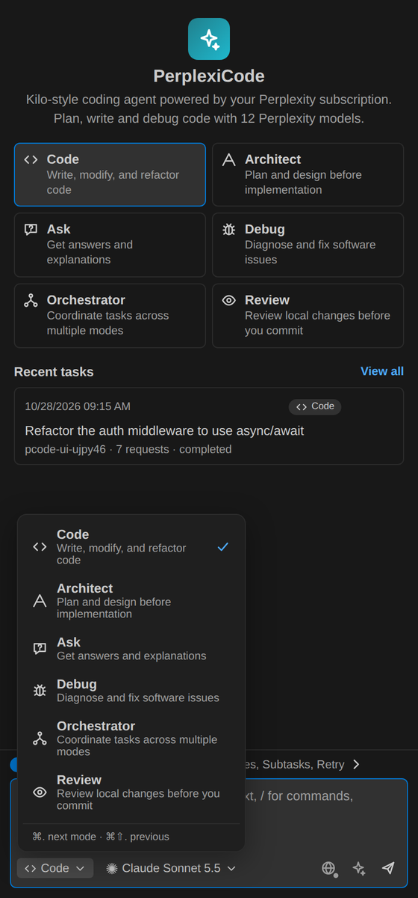<br /><sub>Modes (<code>Cmd+.</code> cycles)</sub></td>
  </tr>
  <tr>
    <td align="center">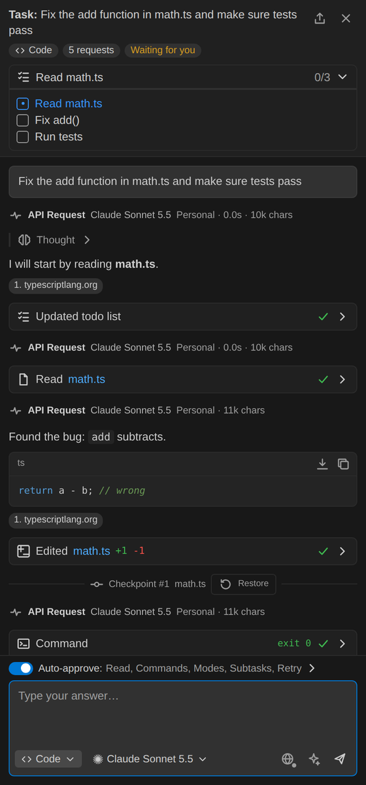<br /><sub>Agent task with todo list, tools and checkpoints</sub></td>
    <td align="center">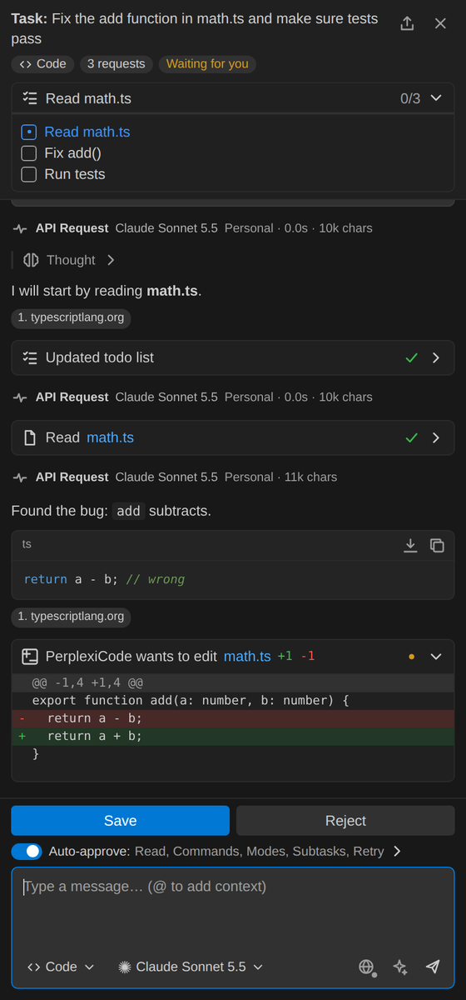<br /><sub>Edit approval with inline diff</sub></td>
    <td align="center">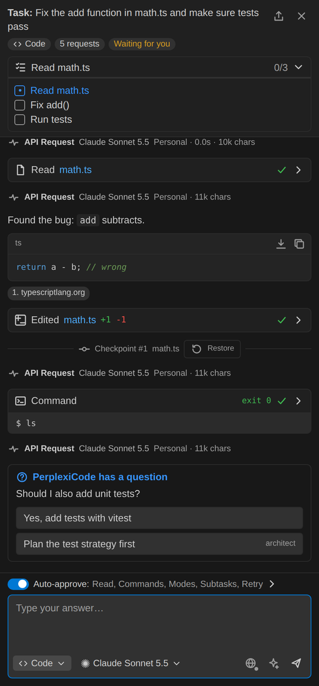<br /><sub>Commands and follow-up questions</sub></td>
  </tr>
  <tr>
    <td align="center">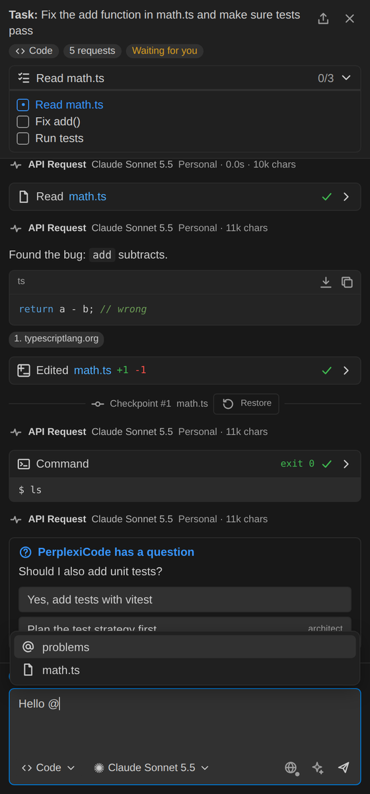<br /><sub><code>@</code> mentions</sub></td>
    <td align="center">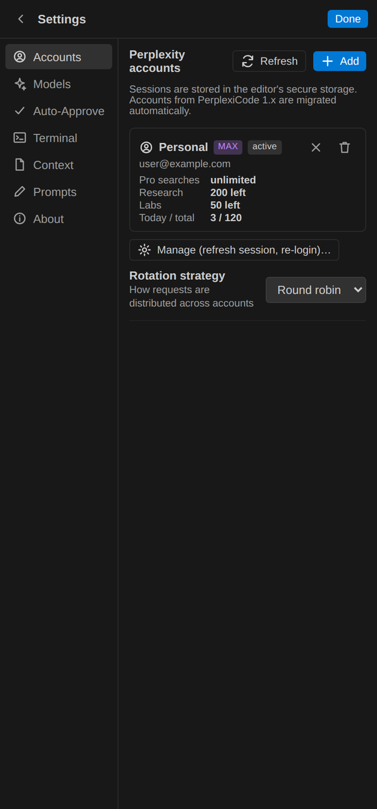<br /><sub>Accounts, models, auto-approve, terminal, context, prompts</sub></td>
    <td align="center">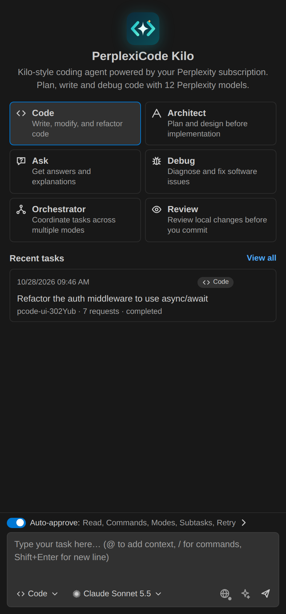<br /><sub>Welcome screen and recent tasks</sub></td>
  </tr>
</table>

<sub>Screenshots are rendered from the test fixture (`npm run test:webview`) with sample data.</sub>

---

## Models

The model list matches the current Perplexity picker. It is loaded live from your account's model config, with a bundled snapshot (2026-10-28, 89 models) as a fallback.

| Model | Provider | Plan | Thinking |
| --- | --- | :---: | :---: |
| Best | Perplexity | Free | — |
| GPT-6.1 Sol | OpenAI | Pro | ✓ |
| GPT-6 Astra | OpenAI | **Max** | ✓ |
| Gemini 4 Argon `NEW` | Google | **Max** | ✓ |
| Gemini 3.8 Flash | Google | Pro | ✓ |
| Claude Sonnet 5.5 | Anthropic | Pro | ✓ |
| Claude Opus 5.5 | Anthropic | **Max** | ✓ |
| Claude Fable 5.1 | Anthropic | **Max** | ✓ |
| Kimi K3 | Moonshot AI | Pro | built-in |
| GLM 5.3 | Z.ai | Pro | built-in |
| Grok 4.7 | xAI | Pro | ✓ |
| Nemotron 3.5 Super VL | NVIDIA | Pro | — |
| **More models** (77) | Anthropic, OpenAI, Google, xAI, Perplexity Sonar… | Pro / Max | per model |

Max models unlock automatically for Max accounts. If a Max model is picked on a Pro-only account pool, the request falls back to **Best**. Override plan detection with `perplexicodeKilo.subscriptionPlan` if needed, and use **PerplexiCode: Refresh Models and Quotas** after Perplexity adds new models.

---

## Modes

| Mode | Purpose | Tools |
| --- | --- | --- |
| **Code** | Write, modify and refactor code | read, edit, command, modes |
| **Architect** | Plan and design before implementation | read, edit Markdown only, modes |
| **Ask** | Answers and explanations | read |
| **Debug** | Systematic diagnosis and fixes | read, edit, command, modes |
| **Orchestrator** | Split work into subtasks across modes | modes, subtasks |
| **Review** | Review local changes before you commit | read, command, modes |

Agent tools: `read_file`, `list_files`, `search_files`, `list_code_definition_names`, `apply_diff`, `write_to_file`, `insert_content`, `execute_command`, `ask_followup_question`, `attempt_completion`, `switch_mode`, `new_task`, `update_todo_list`.

---

## Commands and shortcuts

| Command | macOS | Windows / Linux |
| --- | --- | --- |
| PerplexiCode: Open Agent | `Cmd+Alt+K` | `Ctrl+Alt+K` |
| PerplexiCode: New Task | `Cmd+Alt+N` | `Ctrl+Alt+N` |
| PerplexiCode: Switch to Next Mode | `Cmd+.` | `Ctrl+.` |
| PerplexiCode: Add Selection to Chat | `Cmd+Shift+I` | `Ctrl+Shift+I` |
| PerplexiCode: Add to Context | `Cmd+K Cmd+A` | `Ctrl+K Ctrl+A` |
| PerplexiCode: Explain / Fix / Improve Code | context menu, lightbulb | context menu, lightbulb |
| PerplexiCode: Explain Current File | Command Palette | Command Palette |
| PerplexiCode: Add Terminal Selection to Context | terminal context menu | terminal context menu |
| PerplexiCode: Generate Commit Message | Source Control title bar | Source Control title bar |
| PerplexiCode: Select Model / Mode | status bar | status bar |
| PerplexiCode: Task History · Settings · Open in Editor Tab | view title bar | view title bar |
| PerplexiCode: Add / Manage Accounts · Set Account Rotation Strategy · Refresh Models and Quotas | Command Palette | Command Palette |

---

## Settings

<details>
<summary><b>All settings</b> (click to expand)</summary>

| Setting | Default | Description |
| --- | --- | --- |
| `perplexicodeKilo.defaultModel` | `turbo` (Best) | Model for new tasks. |
| `perplexicodeKilo.subscriptionPlan` | `auto` | Force `pro` or `max` when detection is wrong. |
| `perplexicodeKilo.agent.autoApprove.enabled` | `true` | Master switch for auto-approval. |
| `perplexicodeKilo.agent.autoApprove.read` | `true` | Reading, listing and searching inside the workspace. |
| `perplexicodeKilo.agent.autoApprove.readOutsideWorkspace` | `false` | Reads outside the workspace. |
| `perplexicodeKilo.agent.autoApprove.write` | `false` | Creating and editing files. |
| `perplexicodeKilo.agent.autoApprove.execute` | `false` | Commands matching `allowedCommands`. |
| `perplexicodeKilo.agent.autoApprove.modeSwitch` | `true` | Mode switches requested by the agent. |
| `perplexicodeKilo.agent.autoApprove.subtasks` | `true` | Orchestrator subtasks. |
| `perplexicodeKilo.agent.autoApprove.todo` | `true` | Todo list updates. |
| `perplexicodeKilo.agent.autoApprove.retry` | `true` | Retry failed Perplexity requests. |
| `perplexicodeKilo.agent.allowedCommands` | `npm test`, `npm run`, `git status`, `git diff`, `git log`, `ls`, `cat`, `pwd` | Command prefixes that may run without approval (`*` = all). |
| `perplexicodeKilo.agent.deniedCommands` | `rm -rf`, `sudo`, `git push --force` | Prefixes that always need approval. |
| `perplexicodeKilo.agent.maxRequestsPerTask` | `40` | Ask before continuing after this many requests. |
| `perplexicodeKilo.agent.maxReadFileLines` | `500` | Lines per `read_file` call. |
| `perplexicodeKilo.agent.commandTimeoutSeconds` | `120` | Command timeout, `0` = none. |
| `perplexicodeKilo.agent.terminalOutputLineLimit` | `300` | Terminal lines sent to the model. |
| `perplexicodeKilo.agent.webSearch` | `auto` | Whether Perplexity may search the web for agent requests. |
| `perplexicodeKilo.agent.contextStrategy` | `auto` | Thread follow-ups or full self-contained prompts. |
| `perplexicodeKilo.agent.maxPromptChars` | `60000` | Prompt size limit; older turns are condensed. |
| `perplexicodeKilo.agent.language` | `auto` | Reply language, e.g. `en`, `ru`. |
| `perplexicodeKilo.agent.customInstructions` | — | Instructions added to every mode. |
| `perplexicodeKilo.agent.modeInstructions` | `{}` | Per-mode instructions keyed by mode slug. |
| `perplexicodeKilo.agent.diffEnabled` | `true` | Use `apply_diff` instead of full rewrites. |
| `perplexicodeKilo.agent.includeFileListOnStart` | `true` | Send the workspace file list with the first request. |
| `perplexicodeKilo.agent.revealEditedFiles` | `true` | Open files after the agent edits them. |
| `perplexicodeKilo.excludePatterns` | `node_modules`, `.git`, `dist`, `out`, `.next` | Globs excluded from context. |

</details>

---

## How it works

1. You describe a task; PerplexiCode builds a system prompt for the active mode with tool descriptions, workspace rules, the file list and your `@` mentions.
2. The prompt goes to Perplexity through your web session, using the selected model (and Thinking variant, if enabled).
3. The reply is parsed for one XML tool call. Reads run immediately if auto-approved; edits and commands wait for **Save** / **Run** unless auto-approved.
4. The tool result is sent back as the next message, and the loop continues until `attempt_completion`.
5. Perplexity thread follow-ups are used when possible. If a follow-up fails, the full conversation is resent as one prompt, and accounts fail over on quota or auth errors.

## Build from source

Requirements: [Node.js](https://nodejs.org/) 20+ and npm.

```bash
git clone https://github.com/MRX7999/PerplexiCode-Kilo.git
cd PerplexiCode-Kilo
npm ci
npm run lint                                   # extension + webview type check
npm test                                       # parser, diff engine, tools, models, agent loop, transport
npx vsce package --out perplexicode-kilo.vsix  # build the VSIX
```

`npm run test:webview` renders the webview in headless Chromium and saves screenshots to `out/test/` (needs a [Playwright](https://playwright.dev/) Chromium in `~/.cache/ms-playwright`).

Releases are built by [GitHub Actions](.github/workflows/release.yml): pushing a `vX.Y.Z` tag runs the tests, packages the VSIX and attaches it to a GitHub release.

<details>
<summary><b>Project layout</b></summary>

```text
src/
  extension.ts          activation, commands, code actions, webview providers
  agent/                agent loop, modes, prompts, tool parser and executor, diff engine, transport, task store
  api/                  Perplexity client, model catalog, bundled model config, quotas, account rotation
  providers/            login flows
  storage/              account manager (SecretStorage)
  ui/                   status bar
webview-ui/agent/       chat UI (TypeScript + CSS, bundled with esbuild)
test/                   unit and agent tests, webview render harness
scripts/                install.sh, install.ps1
```

</details>

## Troubleshooting

| Problem | Fix |
| --- | --- |
| Max models are locked on a Max account | Run **Refresh Models and Quotas**, or set `perplexicodeKilo.subscriptionPlan` to `max`. |
| `401` / session expired | **Manage Accounts** → refresh session, or add the account again. |
| The CLI says `NOT registered` | Harmless Antigravity warning; check `--list-extensions --show-versions`. |
| Install script cannot find the editor | Pass `--vsix` with a downloaded file, or use **Install from VSIX…**. |
| Agent stops after many steps | Raise `perplexicodeKilo.agent.maxRequestsPerTask`. |
| `Unable to write to User Settings … is not a registered configuration` | The extension was updated while the window stayed open. Run **Developer: Reload Window**. Since 2.1.0 the change is saved anyway and moved into settings after the reload. |
| Anything else | Open **Output → PerplexiCode** and attach the log to an [issue](https://github.com/MRX7999/PerplexiCode-Kilo/issues). |

## Credits

- Original extension: [yuki-20/PerplexiCode](https://github.com/yuki-20/PerplexiCode) (MIT).
- Agent design, modes and tool protocol follow [Kilo Code](https://github.com/Kilo-Org/kilocode), itself based on [Roo Code](https://github.com/RooCodeInc/Roo-Code) and [Cline](https://github.com/cline/cline).

## Disclaimer

PerplexiCode is an unofficial community project and is not affiliated with or endorsed by Perplexity AI, Kilo Code or Google. It uses your own Perplexity web session; usage counts against your subscription limits and is subject to the [Perplexity Terms of Service](https://www.perplexity.ai/hub/legal/terms-of-service).

## License

[MIT](LICENSE). Original work © yuki-20; PerplexiCode Kilo changes © MRX7999.
