<div align="center">

# PerplexiCode Kilo

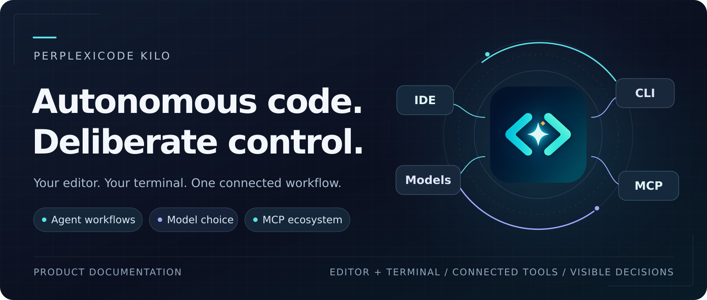

[](https://github.com/MRX7999/PerplexiCode-Kilo/releases/latest)
[](https://marketplace.visualstudio.com/items?itemName=MRX7999.perplexicode-kilo)
[](https://open-vsx.org/extension/MRX7999/perplexicode-kilo)
[](https://open-vsx.org/extension/MRX7999/perplexicode-kilo)
[](https://github.com/MRX7999/PerplexiCode-Kilo/actions/workflows/ci.yml)
[](https://github.com/MRX7999/PerplexiCode-Kilo/releases)
[](https://code.visualstudio.com/)
[](https://antigravity.google/download)
[](LICENSE)

[Overview](#features) · [Install](#install) · [What's new in 4.0](#40-remote-core-lsp-repl--quick-edit) · [3.5–3.8](#38-mcp-oauth-slash-prompts--cross-model-review) · [Interface & agents](#31-agents-skills--presets) · [MCP catalog](#34-mcp-catalog-security-and-parrot-os) · [MCP & compute](#33-mcp-servers-and-compute-modes) · [CLI](#30-headless-core--pcode-cli) · [Models](#models) · [Commands](#commands-and-shortcuts) · [Settings](#settings) · [Migrating to 4.0](#migrating-to-40) · [Build](#build-from-source) · [Help](#troubleshooting)

[Core reference](docs/CORE-3.0.md) · [Security policy & threat model](SECURITY.md) · [Security & Parrot OS guide](docs/MCP-SECURITY-PARROT.md)

</div>

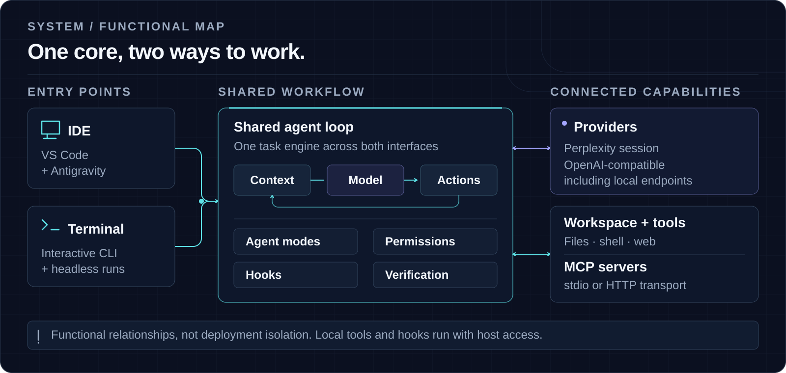

<a id="features"></a>
<a id="modes"></a>
<a id="how-it-works"></a>
<details>
<summary><strong>Overview</strong> · Capabilities, modes and the shared agent loop</summary>

### Features

**A Kilo Code-style autonomous coding agent for Antigravity IDE and VS Code, powered by your Perplexity Pro / Max subscription.**

Plan, write, run and debug code with GPT-6.2 Sol, Claude Opus 5.5, Gemini 4 Carbon, Grok 4.7 and 120+ more Perplexity models. No API keys. Run the same agent core in the editor, in the terminal as `pcode`, or as a remote daemon on a build box — your Perplexity session never leaves your machine.

| | |
| --- | --- |
| **Agent loop** | The model works step by step with tools, sees each result and continues until the task is done — the way [Kilo Code](https://github.com/Kilo-Org/kilocode) works. |
| **Six modes** | Code, Architect, Ask, Debug, Orchestrator and Review, each with its own prompt and tool permissions. |
| **Diff approvals** | Every edit is shown as an inline diff with **Save** / **Reject**; commands get **Run** / **Reject**. |
| **Auto-approve** | Separate toggles for reads, writes, commands (allow and deny prefixes), mode switches, subtasks, todo updates and retries, plus a request limit. |
| **Checkpoints** | A checkpoint after every edit with one-click **Restore**. |
| **Context mentions** | `@repo` (structural symbol/import/test map), `@/path/to/file`, `@/folder/`, `@problems`, `@git-changes`, `@selection`. |
| **Editor actions** | Explain / Fix / Improve / Add to Context from the context menu and lightbulb quick fixes; terminal selection to context. |
| **Workspace rules** | Loads `AGENTS.md`, `.kilocode/rules`, `.roo/rules`, `.clinerules` and `~/.kilocode/rules`. |
| **Task UI** | Todo list with progress, streaming Markdown, reasoning blocks, tool cards, terminal output, follow-up suggestions, prompt enhancer. |
| **History** | Searchable task history; reopen, delete or export past tasks. |
| **Commit messages** | Generates a commit message from staged changes in the Source Control view. |
| **Multi-account** | Several Perplexity accounts with quota display and automatic failover. |
| **Remote core** (4.0) | `pcode serve` runs the agent core as a daemon on a `0600` Unix socket or a token-protected WebSocket. The IDE connects as a client; model calls stay on the IDE machine. See [4.0](#40-remote-core-lsp-repl--quick-edit). |
| **`lsp` tool** (4.0) | Go to definition, find references, hover and diagnostics for the agent — VS Code language providers in the IDE, `.lsp.json` servers in the CLI. |
| **Quick Edit** (4.0) | `Cmd/Ctrl+I` on a selection: describe the change and watch it stream into a side-by-side diff before you apply it. |
| **REPL upgrades** (4.0) | `!<command>` runs a local command and adds its output to the context, `/rewind` rolls back files *and* the conversation, long commands show a live timer. |
| **Model catalog updates** (4.0) | `pcode models update` / **Update Model Catalog from Repository** pulls a SHA-256 verified model list without waiting for a release; the bundled snapshot stays as the fallback. |
| **MCP OAuth & `/server:skill`** (3.8) | OAuth 2.0 + PKCE sign-in for remote MCP servers, MCP prompts in the `/` menu, argument-level permission rules and an optional cross-model review before completion. See [3.8](#38-mcp-oauth-slash-prompts--cross-model-review). |
| **Worktrees & parallel subagents** (3.7) | Run a task in an isolated git worktree, review the result card, then **Apply** or **Discard** — nothing is merged or pushed for you. Orchestrator runs subagents in parallel. See [3.7](#37-worktree-isolation--parallel-subagents). |
| **Context intelligence** (3.6) | `@repo` structural map, new-error diagnostics after every edit, a live Context Inspector and structured auto-compaction. See [3.6](#36-context-intelligence). |
| **Reliability & hardening** (3.5) | Safe resume, visible task state and model route, SSRF-safe `web_fetch`, a segment-level shell parser, verified installers and a redacted diagnostics bundle. See [3.5](#35-reliability--security-hardening). |
| **MCP servers** (3.3) | Connect Claude Code style MCP servers (stdio, HTTP, SSE) from `.mcp.json`, `~/.claude.json` and settings. Their tools, resources and prompts are available to the agent with `mcp__server__tool` permission rules. See [3.3](#33-mcp-servers-and-compute-modes). |
| **Compute modes** (3.3) | Pick how Perplexity runs the request: Search, Computer harness (Light / Standard / High / Ultra), Deep Research or Labs, with automatic fallback when your plan does not include a mode. |
| **Agents, Skills & Presets** (3.1) | One-click subagents and skills from a built-in catalog, and task presets that set the mode, subagent and prompt for common jobs. See [below](#31-agents-skills--presets). |
| **`pcode` CLI** (3.0) | The same agent core in the terminal, Claude Code style. See [3.0](#30-headless-core--pcode-cli). |

### Modes

| Mode | Purpose | Tools |
| --- | --- | --- |
| **Code** | Write, modify and refactor code | read, edit, command, modes |
| **Architect** | Plan and design before implementation | read, edit Markdown only, modes |
| **Ask** | Answers and explanations | read |
| **Debug** | Systematic diagnosis and fixes | read, edit, command, modes |
| **Orchestrator** | Split work into subtasks across modes | modes, subtasks |
| **Review** | Review local changes before you commit | read, command, modes |

Agent tools: `read_file`, `list_files`, `search_files`, `glob_files`, `list_code_definition_names`, `apply_diff`, `write_to_file`, `insert_content`, `search_and_replace`, `execute_command`, `web_fetch`, `lsp`, `use_mcp_tool`, `access_mcp_resource`, `list_mcp_resources`, `ask_followup_question`, `attempt_completion`, `switch_mode`, `new_task`, `update_todo_list`.

### How it works

1. You describe a task; PerplexiCode builds a system prompt for the active mode with tool descriptions, workspace rules, the file list and your `@` mentions.
2. The prompt goes to Perplexity through your web session, using the selected model (and Thinking variant, if enabled).
3. The reply is parsed for one XML tool call. Reads run immediately if auto-approved; edits and commands wait for **Save** / **Run** unless auto-approved.
4. The tool result is sent back as the next message, and the loop continues until `attempt_completion`.
5. Perplexity thread follow-ups are used when possible. If a follow-up fails, the full conversation is resent as one prompt, and accounts fail over on quota or auth errors.
6. Every request shows its route — requested mode and model → what actually answered, and why. A dropped stream is retried without applying an edit or running a command twice.

</details>

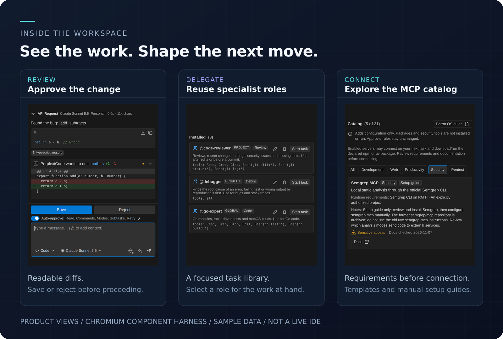

<a id="install"></a>
<a id="from-the-extensions-view"></a>
<a id="one-line-install-from-github-releases"></a>
<a id="manual-install-with-the-antigravity-cli"></a>
<a id="install-from-the-editor-ui"></a>
<a id="after-installing"></a>
<a id="moving-from-perplexicode-1x--20"></a>
<a id="sign-in"></a>
<details>
<summary><strong>Install & sign in</strong> · Editor setup, migration and account storage</summary>

Extension ID: **`MRX7999.perplexicode-kilo`**

### From the Extensions view

VS Code: [Visual Studio Marketplace](https://marketplace.visualstudio.com/items?itemName=MRX7999.perplexicode-kilo) — search for **PerplexiCode Kilo** in the Extensions view or run `code --install-extension MRX7999.perplexicode-kilo`.


Antigravity IDE, Cursor, Windsurf and VSCodium use [Open VSX](https://open-vsx.org/extension/MRX7999/perplexicode-kilo). Open the Extensions view (`Cmd/Ctrl+Shift+X`), search for **PerplexiCode Kilo** and click **Install**, or run:

```bash
antigravity-ide --install-extension MRX7999.perplexicode-kilo
```

### One-line install from GitHub Releases

**macOS / Linux** — installs the latest release into Antigravity IDE:

```bash
curl -fsSL https://raw.githubusercontent.com/MRX7999/PerplexiCode-Kilo/master/scripts/install.sh | bash
```

**Windows (PowerShell):**

```powershell
irm https://raw.githubusercontent.com/MRX7999/PerplexiCode-Kilo/master/scripts/install.ps1 | iex
```

Other editors: add `--ide code`, `--ide cursor`, `--ide windsurf` or `--ide all` (PowerShell: `-Ide code`):

```bash
curl -fsSL https://raw.githubusercontent.com/MRX7999/PerplexiCode-Kilo/master/scripts/install.sh | bash -s -- --ide all
```

The scripts download [`perplexicode-kilo.vsix`](https://github.com/MRX7999/PerplexiCode-Kilo/releases/latest/download/perplexicode-kilo.vsix) from the [latest release](https://github.com/MRX7999/PerplexiCode-Kilo/releases/latest), verify it against `SHA256SUMS.txt` from the same release (and stop on a mismatch), find the editor CLI on your `PATH` or inside the app bundle, install with `--force` and print the installed version. Read them first: [install.sh](scripts/install.sh), [install.ps1](scripts/install.ps1).

### Manual install with the Antigravity CLI

Download [`perplexicode-kilo.vsix`](https://github.com/MRX7999/PerplexiCode-Kilo/releases/latest/download/perplexicode-kilo.vsix), then:

```bash
# macOS — Antigravity IDE
"/Applications/Antigravity IDE.app/Contents/Resources/app/bin/antigravity-ide" \
  --install-extension ~/Downloads/perplexicode-kilo.vsix --force

# Windows — Antigravity IDE
"%LOCALAPPDATA%\Programs\Antigravity IDE\bin\antigravity-ide.cmd" --install-extension "%USERPROFILE%\Downloads\perplexicode-kilo.vsix" --force

# VS Code / Cursor / Windsurf
code --install-extension perplexicode-kilo.vsix --force
```

The CLI may print `antigravityAnalytics ... NOT registered` — that line is harmless.

### Install from the editor UI

Extensions view (`Cmd/Ctrl+Shift+X`) → `…` menu → **Install from VSIX…** → pick the downloaded file.

### After installing

1. Reload the window: `Cmd/Ctrl+Shift+P` → **Developer: Reload Window**.
2. Open the **PerplexiCode** icon in the activity bar.
3. Sign in (see below) and start a task.

### Moving from PerplexiCode 1.x / 2.0

Since 2.1.0 the extension has its own ID, `MRX7999.perplexicode-kilo` (it was `perplexicode.perplexicode`). Editors keep each extension's secrets separate, so accounts are moved once, with your confirmation:

1. Install PerplexiCode Kilo next to the old extension and reload the window.
2. Click **Import accounts** in the notification. A small bundled helper ([source](bridge/extension.js)) takes over the old ID — it has no UI and makes no network requests.
3. Reload again and confirm **Copy accounts** in the dialog. Sessions, CSRF tokens, cookies and the rotation strategy are copied locally; duplicates are skipped.
4. Click **Uninstall old extension**.

User settings `perplexicode.*` are copied to `perplexicodeKilo.*` automatically. You can rerun the import with **PerplexiCode: Import Accounts from PerplexiCode 1.x**.

### Sign in

Run **PerplexiCode: Add Perplexity Account** and pick one method:

| Method | How it works |
| --- | --- |
| **Import from Browser** (recommended) | Reads your existing `perplexity.ai` session from Chrome, Edge or Brave. |
| **Auto Login** | Opens a browser window, you log in, the session is captured. |
| **Manual Paste** | Paste the full `Cookie` header from DevTools → Network on [perplexity.ai](https://www.perplexity.ai). |

Sessions are kept in the editor's [SecretStorage](https://code.visualstudio.com/api/references/vscode-api#SecretStorage). You can add several accounts; requests are spread across them with **round-robin**, **least-used** or **failover-only** rotation.

</details>

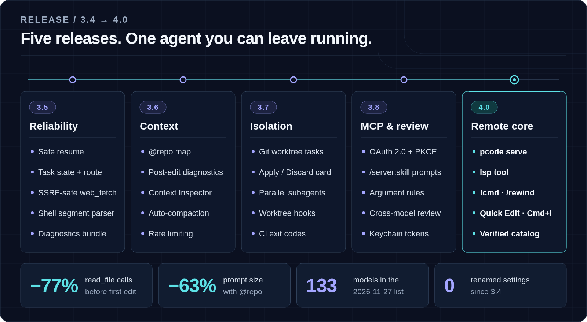

<a id="40-remote-core-lsp-repl--quick-edit"></a>
<a id="whats-new-in-40"></a>
<details open>
<summary><strong>What's new · 4.0</strong> · Remote core, LSP tool, REPL rewind, verified model catalog and Quick Edit</summary>

### Remote core — `pcode serve`

Run the agent core on another machine (a build server, a VM, a container) and drive it from your editor. File tools, commands and LSP run on the daemon; every model request is sent back to the IDE and goes to Perplexity from there. Cookies, CSRF tokens and session tokens are never sent over the wire — the daemon rejects any message that carries them (`RemoteSecurityViolationError`).

| | |
| --- | --- |
| **Unix socket** (default) | `~/.perplexicode/serve.sock`, created with `0600` permissions. |
| **WebSocket** | `--port <n>` (or `--ws` for a random port) on `127.0.0.1`; `--host` to change the interface. Every connection needs the bearer token, compared in constant time. |
| **Token** | `PCODE_SERVE_TOKEN`, `--token-env <VAR>`, `--token-stdin`, or a generated `~/.perplexicode/serve.token` (`0600`). `--token <value>` on the command line is refused with exit code `64`. |
| **IDE** | **PerplexiCode: Remote Core: Connect to pcode serve…** asks for the endpoint (`perplexicodeKilo.remote.url`) and the token, which is kept in SecretStorage. **Remote Core: Disconnect** returns to local mode. |
| **Trust** | Project hooks, MCP and LSP servers on the daemon start only for trusted folders (`--trust-project`). |

```bash
pcode serve                         # Unix socket, token written to ~/.perplexicode/serve.token
pcode serve --port 4190 --token-env PCODE_SERVE_TOKEN   # WebSocket on 127.0.0.1:4190
ssh -L 4190:127.0.0.1:4190 build-box                     # reach a remote daemon through SSH
```

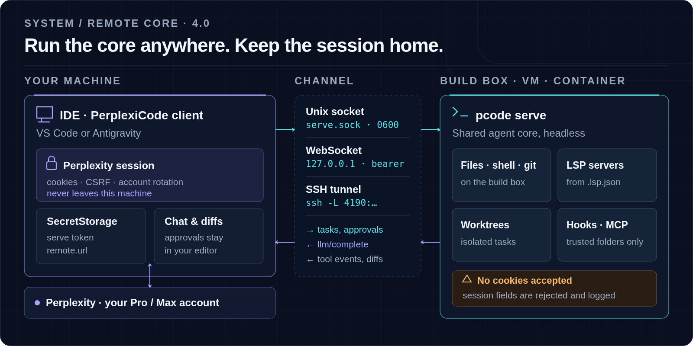

On start the daemon prints one `serve_ready` JSON line with the endpoint and the token source (never the token itself). To reach a daemon on another host, forward the socket or port over SSH instead of binding it to a public interface.

### `lsp` tool

The agent can ask the language server instead of grepping: `definition`, `references`, `hover` and `diagnostics`.

- **IDE** — uses VS Code's own providers for every language you have installed, no setup.
- **CLI / daemon** — reads stdio servers from `.lsp.json` (Claude Code format). Lookup order: `~/.perplexicode/lsp.json` → `~/.claude/.lsp.json` → `.perplexicode/lsp.json` → `.lsp.json`; project files need a trusted folder. Agent edits to `.lsp.json` always ask for confirmation.

```jsonc
// .lsp.json
{
  "servers": {
    "typescript": { "command": "typescript-language-server", "args": ["--stdio"], "extensions": [".ts", ".tsx"] },
    "python": { "command": "pyright-langserver", "args": ["--stdio"], "extensions": [".py"] }
  }
}
```

### REPL

| Input | What happens |
| --- | --- |
| `!npm test` | Runs the command locally and adds the command, exit code and output to the conversation, so the next prompt can refer to it. |
| `/rewind` · `/rewind list` · `/rewind 3` | Rolls back the workspace files (restores edited files, deletes files created after the checkpoint) **and** the session transcript to the latest or the chosen checkpoint. |
| long commands | After one second a live `⏱` timer shows elapsed time (`PCODE_COMMAND_TIMER_MS` changes the threshold). |

### Quick Edit — `Cmd/Ctrl+I`

Select code, press `Cmd+I` (macOS) or `Ctrl+I` (Windows / Linux) and describe the change. The new code streams into a side-by-side diff with `+added / -removed` counters; nothing is written until you click **Apply**. Cancel the progress notification to stop the request. **Add Selection to Chat** is now on `Cmd/Ctrl+Shift+I`.

### Model catalog without a release

`pcode models update` and **PerplexiCode: Update Model Catalog from Repository** download `bundledModelsConfig.json` and its `.sha256` from this repository, check the digest and only then switch to the new list. On a mismatch, broken JSON or a network error the built-in snapshot is used. Point `perplexicodeKilo.models.remoteCatalogUrl` / `remoteCatalogSha256Url` (CLI `--catalog-url` / `--sha256-url`) at your own fork if you maintain one.

### Nightly canary

[`.github/workflows/canary.yml`](.github/workflows/canary.yml) sends one minimal request every night (03:17 UTC) with a test account and opens or updates a “Nightly Perplexity SSE Canary Alert” issue if Perplexity's response format changes. Add the cookie of a test account as the repository secret `PPLX_CANARY_COOKIE`; without it the job is skipped, not failed. Issue text is redacted.

Upgrading from 3.x? Read [Migrating to 4.0](#migrating-to-40) — eleven behaviour changes, no renamed settings.

</details>

<a id="38-mcp-oauth-slash-prompts--cross-model-review"></a>
<details>
<summary><strong>MCP OAuth & review · 3.8</strong> · OAuth 2.0 + PKCE, <code>/server:skill</code>, argument rules and cross-model review</summary>

| | |
| --- | --- |
| **OAuth 2.0 + PKCE** | `pcode mcp login <server>` / `pcode mcp logout <server>`, or **OAuth Login** / **OAuth Logout** on an HTTP/SSE server card in **Library → MCP**. Discovers the authorization server (RFC 8414 / RFC 9728), registers a client when the server supports it (RFC 7591), and receives the code on a `127.0.0.1` loopback. Tokens live in VS Code SecretStorage or the OS keychain (macOS Keychain, `secret-tool`, Windows Credential Manager; a `0600` file on headless systems) and are refreshed on HTTP `401`. |
| **`/server:skill`** | Prompts published by connected MCP servers appear in the composer `/` menu and in the REPL as `/<server>:<prompt> [key="value" …]`. |
| **Argument rules** | `mcp__db__query(sql:SELECT *)`, `mcp__db__query(sql:*DROP*)`, `mcp__k8s__apply({"metadata":{"namespace":"prod*"}})`, `mcp__vault__read_resource(uri:secret://*)`. `deny` wins over `autoApprove.mcp` and `bypassPermissions`, and malformed arguments fail closed. |
| **Cross-model review** | Off by default. With `perplexicodeKilo.agent.crossModelReview` (CLI `--cross-review`) a model from a different family (Anthropic ↔ OpenAI ↔ Google ↔ xAI) reviews the git diff and the `verify` result before `attempt_completion` is accepted. Pick the reviewer with `crossModelReviewModel` / `--cross-review-model`. |

```jsonc
// .claude/settings.json
{
  "permissions": {
    "allow": ["mcp__db__query(sql:SELECT *)"],
    "deny":  ["mcp__db__query(sql:*DROP*)", "mcp__k8s__apply({\"metadata\":{\"namespace\":\"prod*\"}})"]
  }
}
```

<table>
  <tr>
    <td align="center">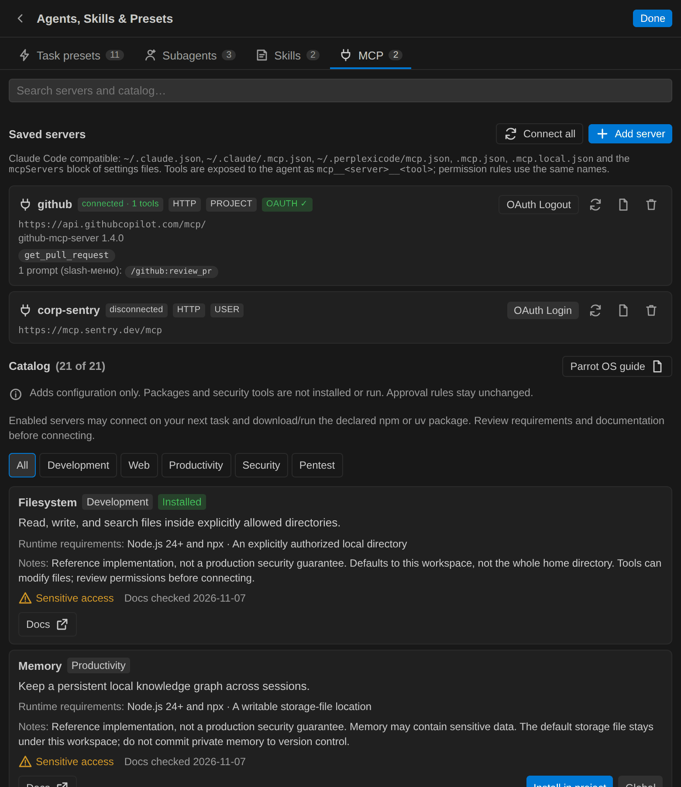<br /><sub>OAuth status and Login / Logout in Library → MCP</sub></td>
    <td align="center">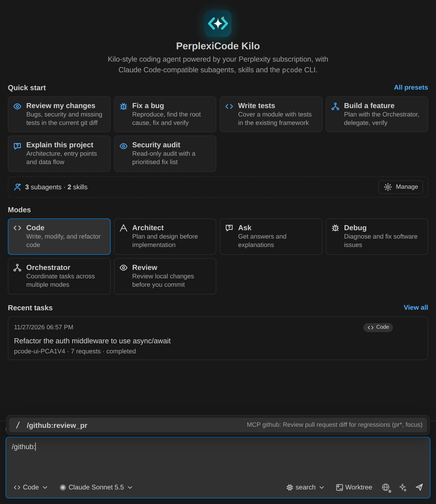<br /><sub>An MCP prompt in the <code>/</code> menu</sub></td>
  </tr>
</table>

OAuth was tested against a local OAuth / PKCE test server, not against a specific vendor.

</details>

<a id="37-worktree-isolation--parallel-subagents"></a>
<details>
<summary><strong>Worktrees · 3.7</strong> · Isolated tasks, Apply / Discard, parallel subagents and CI exit codes</summary>

| | |
| --- | --- |
| **Isolated task** | `pcode -w [name]` / `--worktree`, REPL `/worktree`, or the **Worktree** pill in the composer (`perplexicodeKilo.agent.worktreeEnabled`). The task runs in a detached worktree from `HEAD`. Tools cannot leave it: `..`, symlinks, `git -C`, `--git-dir`, `GIT_DIR`, `cd` outside and `git push` are blocked. Uncommitted changes in your checkout trigger a warning first. |
| **Result card** | Changed files, the diff and the `verify` status, with **Apply** and **Discard**. Apply checks the patch first and writes to your working copy — no `merge`, `commit` or `push`. On a conflict nothing changes and the conflicting files are listed. CLI: `pcode worktree list \| apply <name> \| discard <name>`. |
| **Parallel subagents** | Consecutive `new_task` calls in Orchestrator mode run at the same time, up to `maxParallelSubtasks` (default `3`, CLI `--max-parallel-subtasks`). Read-only subagents share the main tree; each writing subagent gets its own worktree. |
| **Hooks** | `WorktreeCreate` and `WorktreeRemove` receive JSON on stdin, can block with exit code `2` or return a custom `worktreePath`. |
| **Exit codes** | `pcode -p` returns a fixed code per outcome — see the table in [Headless core & pcode CLI](#30-headless-core--pcode-cli). |

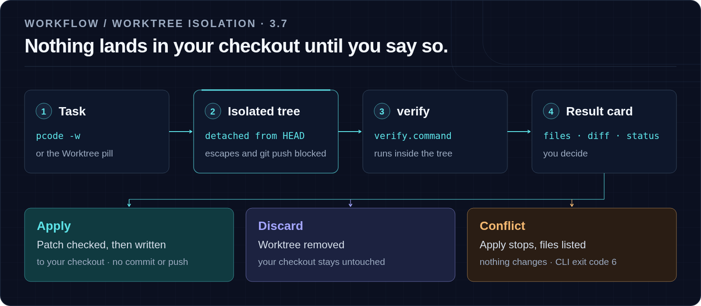

<table>
  <tr>
    <td align="center">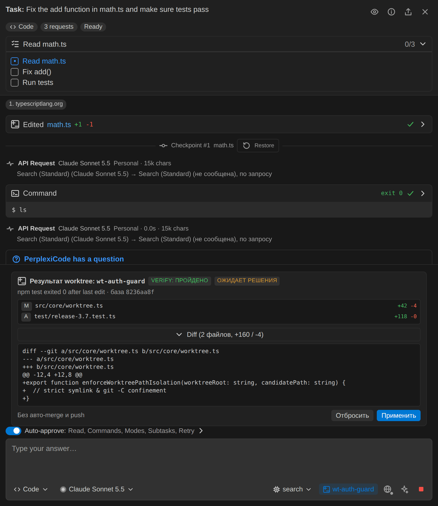<br /><sub>Result card: diff, <code>verify</code>, Apply / Discard</sub></td>
    <td align="center">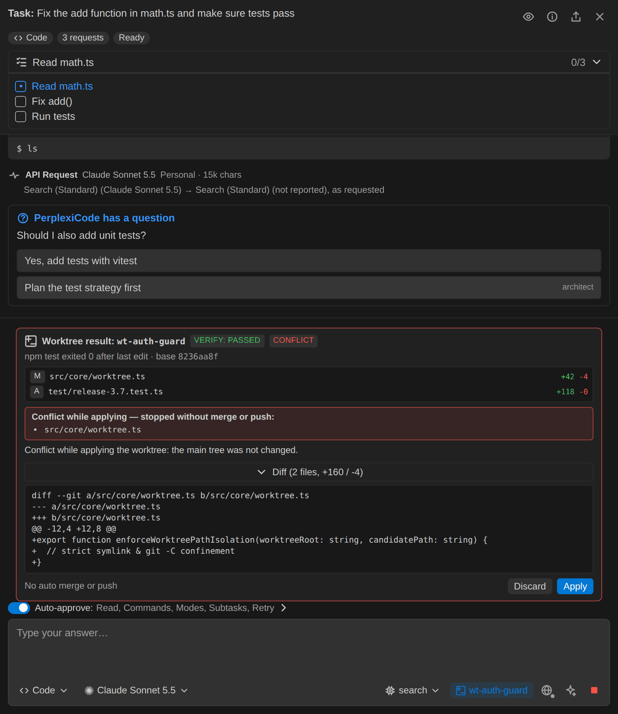<br /><sub>Apply stops on a conflict and lists the files</sub></td>
  </tr>
</table>

</details>

<a id="36-context-intelligence"></a>
<details>
<summary><strong>Context · 3.6</strong> · <code>@repo</code> map, post-edit diagnostics, Context Inspector and auto-compaction</summary>

| | |
| --- | --- |
| **`@repo`** | A structural map of the project — symbols and signatures (TypeScript, JavaScript, Python, Go, Rust), imports, who imports a file and its tests — with the active file and the current git diff first, inside a hard budget (`repoMapMaxChars`, default `6000`). No vector database. On the 24-task benchmark in `src/core/repoMapBench.ts` it cut `read_file` calls before the first edit from 4.29 to 1.00 and prompt size by 63% with the same `verify` pass rate. |
| **Diagnostics after edits** | After `apply_diff`, `write_to_file`, `search_and_replace` and `insert_content` the tool result lists only the errors and warnings the edit introduced. |
| **Context Inspector** | Eye button in the task header, `/context`, or **PerplexiCode: Inspect Task Context…** (REPL `/context [exclude\|include <id>]`): what is in the prompt, why, how many characters, what was compacted — and exclude any item from the next requests. |
| **Auto-compaction** | At `autoCompactThreshold` × `maxPromptChars` (default 80%) older turns become a structured summary — changed files, checked hypotheses, constraints, todo status — while the system prompt and the last `autoCompactKeepSteps` steps stay verbatim. |
| **Rate limits** | Jittered exponential backoff and a per-account cap of `12` requests per minute (`perplexicodeKilo.rotation.maxRequestsPerMinute`, CLI `--max-rpm`). |

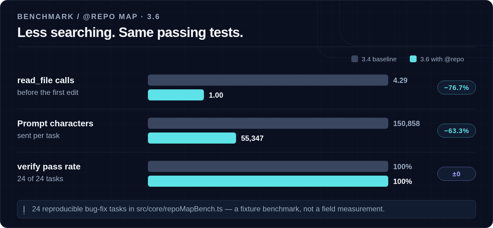

<p align="center">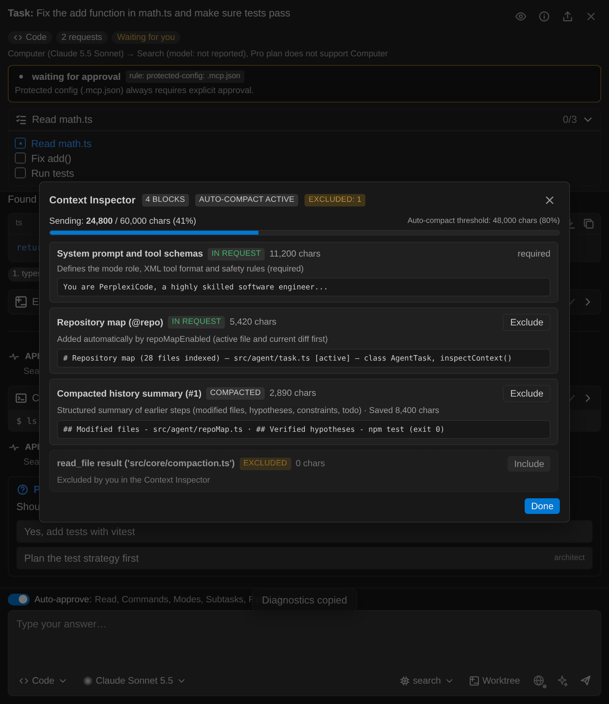<br /><sub>Context Inspector</sub></p>

</details>

<a id="35-reliability--security-hardening"></a>
<details>
<summary><strong>Reliability & security · 3.5</strong> · Safe resume, task state, SSRF and shell hardening, diagnostics</summary>

| | |
| --- | --- |
| **Stream safety** | A repeated final chunk, a stream cut inside a tool call or a reconnect after an applied edit never apply an edit or run a command twice (covered by SSE replay tests). |
| **Safe resume** | A command interrupted before its exit code was recorded is marked *result not confirmed* (`command_unconfirmed`). After `pcode -c` / `-r` or reopening the task, the agent must inspect the workspace before it may run that command again. |
| **Task state** | A status card in the IDE and a status line in the CLI: waiting for approval, retrying, checking the result, or needs you — with the reason and the rule that caused it. |
| **Route line** | Each request shows requested mode/model → actual one and the reason (or *not reported* when Perplexity does not say). `stopOnFallback` (CLI `--stop-on-fallback`) stops instead of silently switching. |
| **`web_fetch` SSRF guard** | Loopback, RFC 1918, link-local, cloud metadata (`169.254.169.254`), CGNAT, ULA, `.localhost` / `.internal` are blocked, re-checked on every redirect. |
| **Shell parser** | Chains (`;`, `&&`, `\|\|`, `\|`, `&`), `env` wrappers and `bash -c` scripts are split and every segment is checked against allow / deny. Substitutions, `eval` and redirections always ask. |
| **Protected configs** | Edits to `.perplexicode/settings*.json`, hooks, `.mcp.json`, `.lsp.json` and `.claude/**` always need your confirmation, even with auto-approve or `bypassPermissions`. See [SECURITY.md](SECURITY.md). |
| **Diagnostics bundle** | `pcode doctor --bundle` or **PerplexiCode: Copy Diagnostics Bundle…** — versions, stage timings and rule decisions, shown in full before export, with no cookies, headers, prompts, code or terminal output. |

<table>
  <tr>
    <td align="center">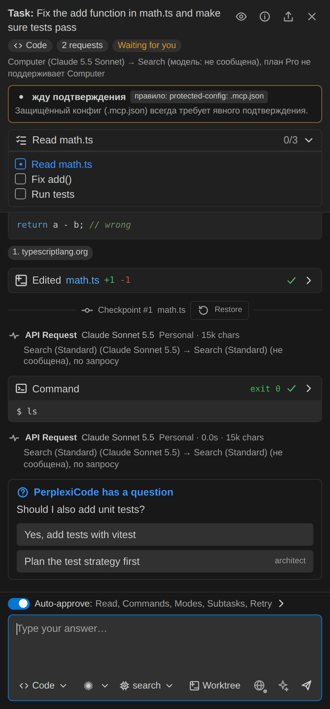<br /><sub>Task state with the rule that stopped it</sub></td>
    <td align="center">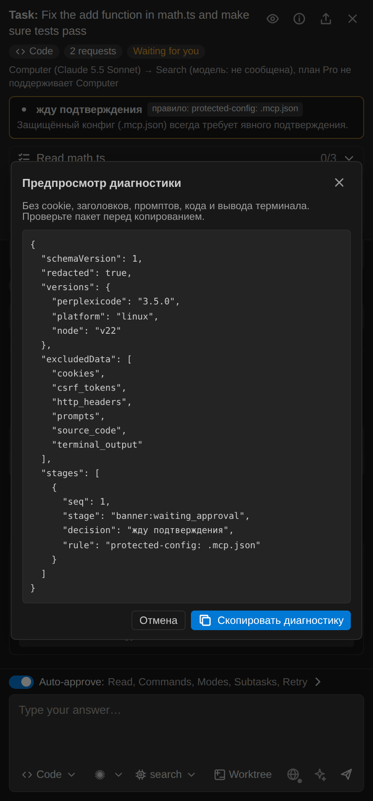<br /><sub>Diagnostics preview before copying</sub></td>
  </tr>
</table>

</details>

<a id="31-agents-skills--presets"></a>
<a id="screenshots"></a>
<details>
<summary><strong>Interface, agents & skills</strong> · Presets, reusable workflows and screenshot gallery</summary>

### Agents, Skills & Presets

Set up subagents and skills from the UI and start common jobs in one click.

| Where | What you get |
| --- | --- |
| **Welcome screen** | A **Quick start** grid with presets (Review my changes, Fix a bug, Write tests, Build a feature, Explain this project, Security audit). The strip below it shows how many subagents and skills are installed and has **Install starter pack**. |
| **Library button** in the view title (or **PerplexiCode: Agents, Skills & Presets**) | Three tabs. **Task presets**: built-in and your own. **Subagents**: installed ones (open, delete, Start task) and a catalog of 8 (`code-reviewer`, `test-writer`, `debugger`, `security-auditor`, `docs-writer`, `refactorer`, `explorer`, `planner`) that you install into the project or globally. **Skills**: 8 catalog skills (`commit-message`, `code-review-checklist`, `write-tests`, `security-audit`, `debug-playbook`, `api-design`, `release-checklist`, `readme-writer`). Each tab has a form for creating your own items. |
| **Mode menu** | A **Subagents** section: pick `@debugger` and the whole task runs as that subagent, with its prompt and tool list. |
| **Composer** | `/presets`, `/agents`, `/skills` and `/<preset-id>` in the slash menu. The selected preset or agent appears as a chip. |
| **Command palette** | **PerplexiCode: Run Task Preset…**. |

A preset sets the mode, subagent and prompt template (`{{input}}` is replaced with what you type). If the preset needs a subagent or skill that isn't installed, PerplexiCode offers to install it into the project or globally, or to run without it.

Files are standard: subagents go to `.perplexicode/agents/<name>.md` (`~/.perplexicode/agents` for global), skills go to `.perplexicode/skills/<name>/SKILL.md`. Your own presets are stored in `.perplexicode/presets.json`, `~/.perplexicode/presets.json` or the `perplexicodeKilo.taskPresets` setting. Later sources override earlier ones in this order: built-in → global file → setting → project file.

The same actions in the terminal:

```bash
pcode agents catalog                 # list catalog subagents
pcode agents add code-reviewer debugger    # into .perplexicode/agents (-g for global)
pcode skills add commit-message -g
pcode presets                        # list task presets
pcode --preset fix-bug -p "login returns 500"
pcode --agent security-auditor -p "audit src/auth"
```

### Screenshots

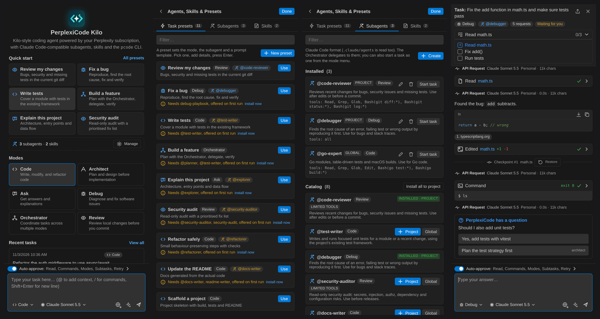

<table>
  <tr>
    <td align="center">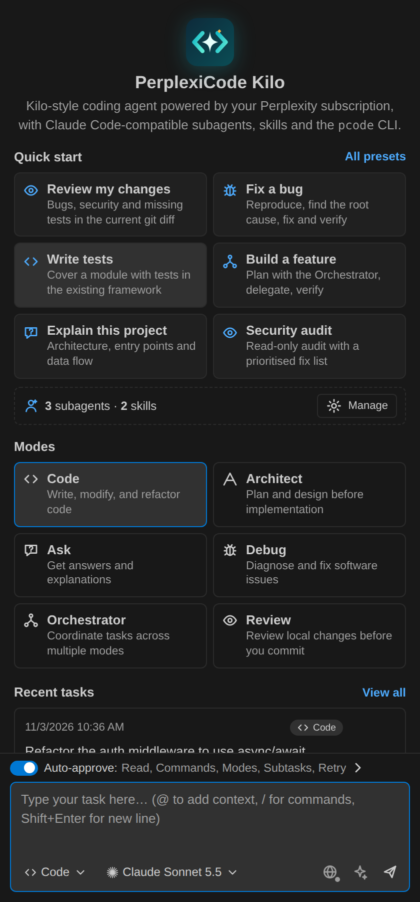<br /><sub>Welcome screen with Quick start presets</sub></td>
    <td align="center">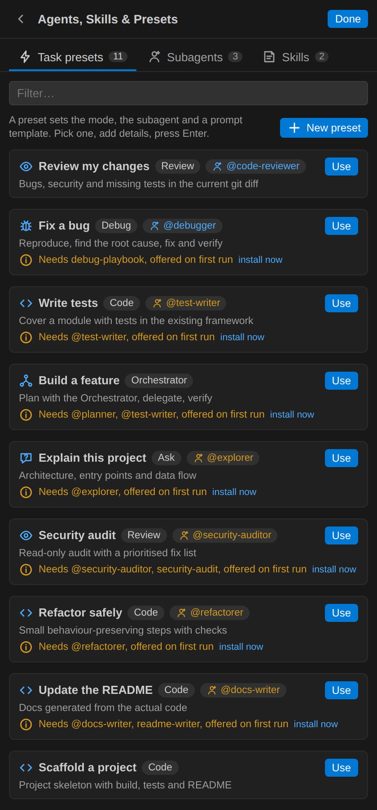<br /><sub>Task presets: mode + subagent + prompt</sub></td>
    <td align="center">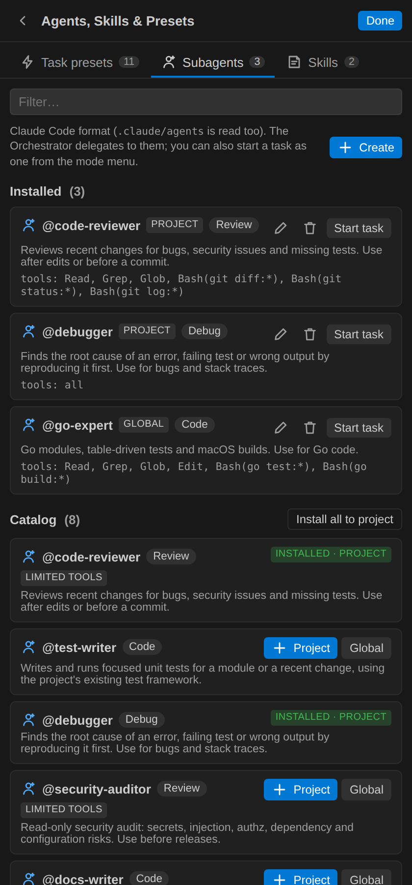<br /><sub>Installed subagents and the catalog</sub></td>
  </tr>
  <tr>
    <td align="center">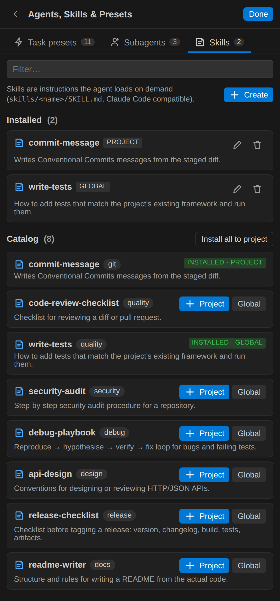<br /><sub>Skills (<code>SKILL.md</code>, Claude Code compatible)</sub></td>
    <td align="center">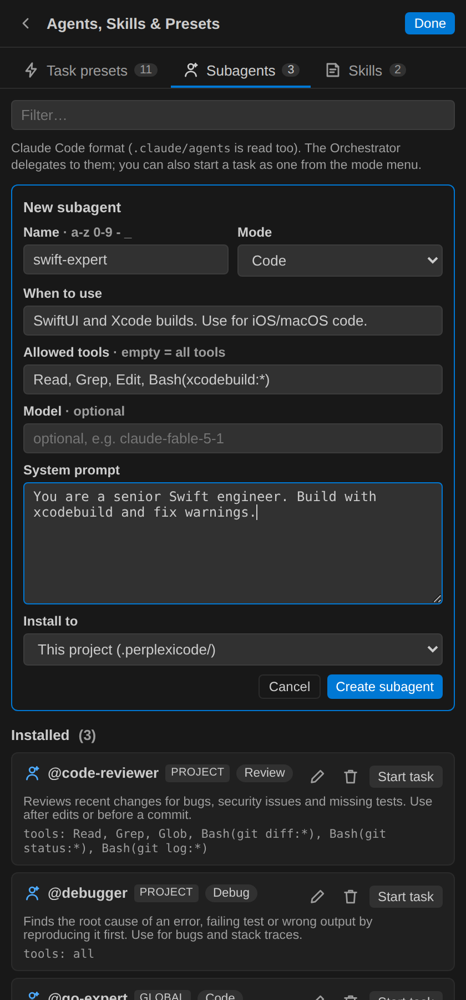<br /><sub>Create your own subagent</sub></td>
    <td align="center">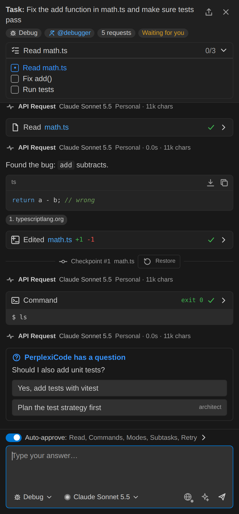<br /><sub>Task run by <code>@debugger</code></sub></td>
  </tr>
  <tr>
    <td align="center">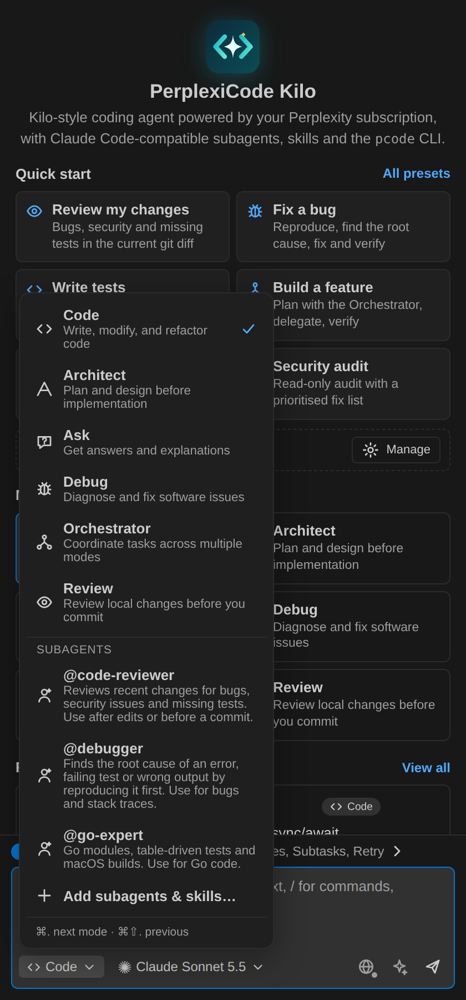<br /><sub>Modes and subagents (<code>Cmd+.</code> cycles modes)</sub></td>
    <td align="center">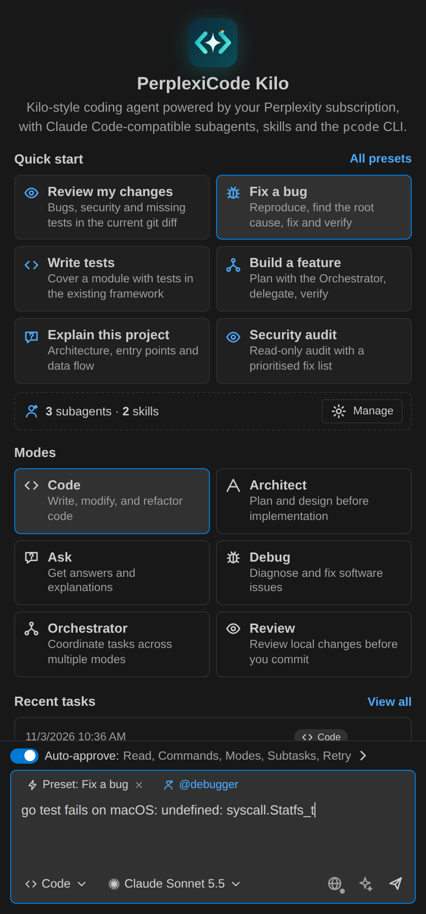<br /><sub>Preset chip in the composer</sub></td>
    <td align="center">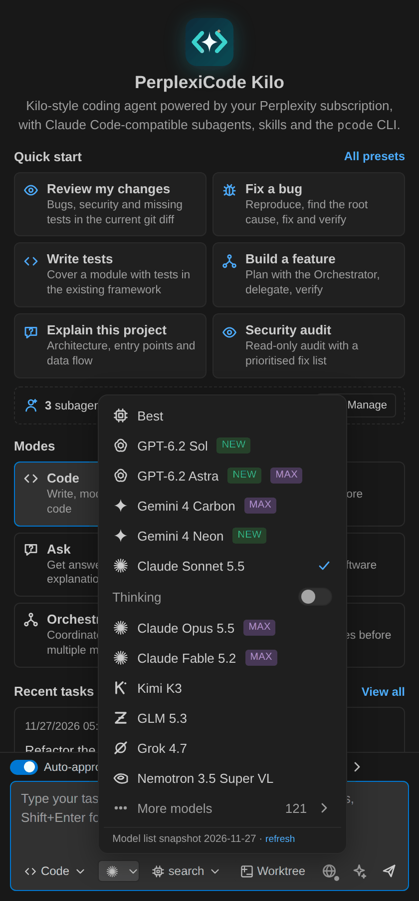<br /><sub>Model picker with Max badges and Thinking toggle</sub></td>
  </tr>
  <tr>
    <td align="center">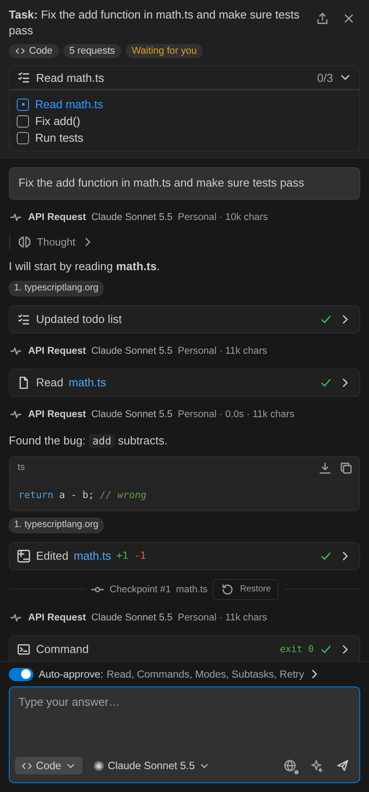<br /><sub>Agent task with todo list, tools and checkpoints</sub></td>
    <td align="center">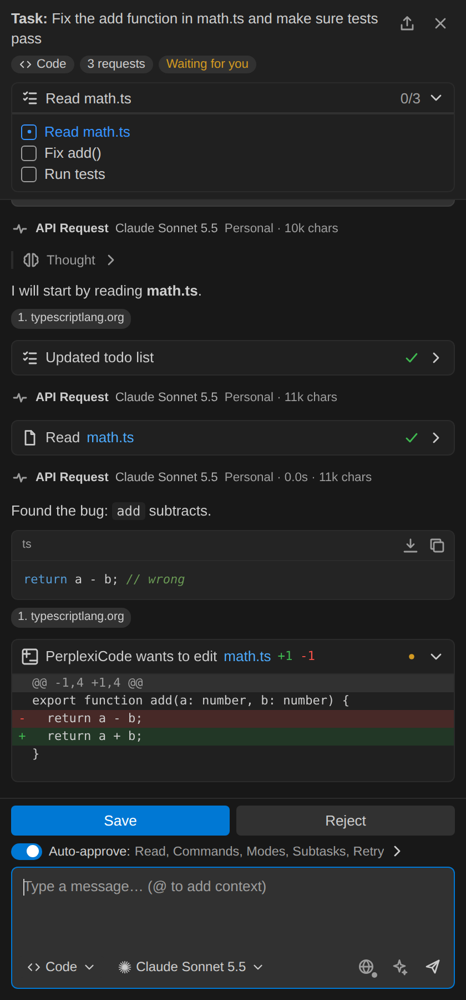<br /><sub>Edit approval with inline diff</sub></td>
    <td align="center">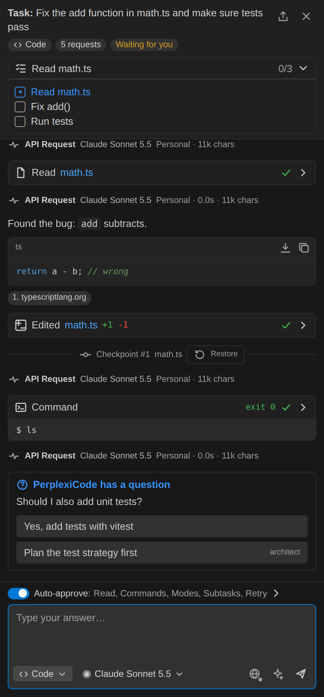<br /><sub>Commands and follow-up questions</sub></td>
  </tr>
  <tr>
    <td align="center">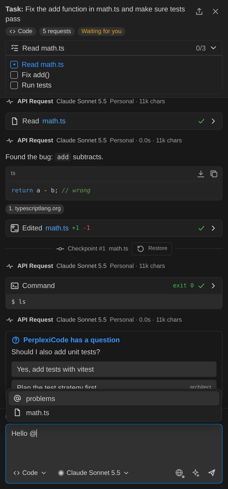<br /><sub><code>@</code> mentions</sub></td>
    <td align="center">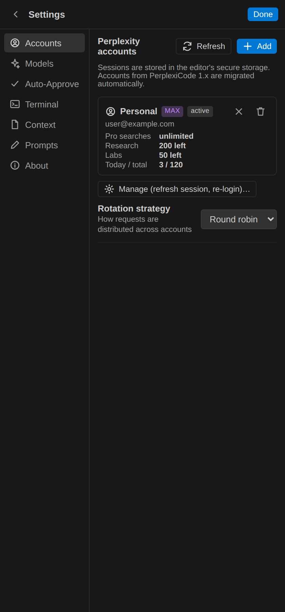<br /><sub>Accounts, models, auto-approve, terminal, context, prompts</sub></td>
    <td align="center">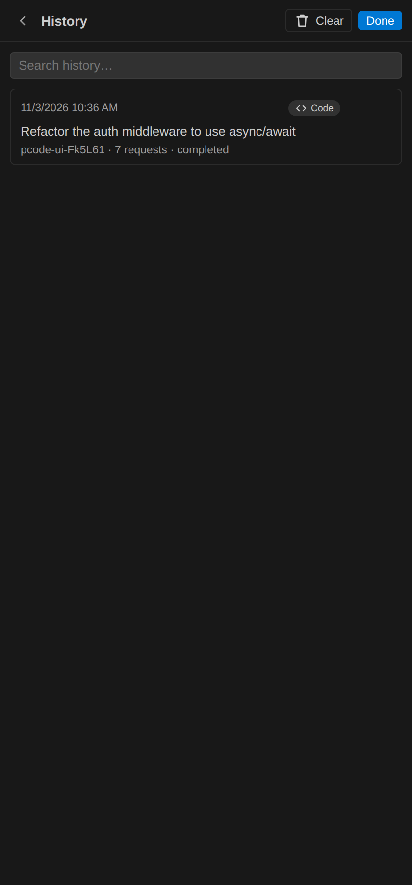<br /><sub>Task history</sub></td>
  </tr>
</table>

<sub>Screenshots are rendered from the test fixture (`npm run test:webview`) with sample data.</sub>

</details>

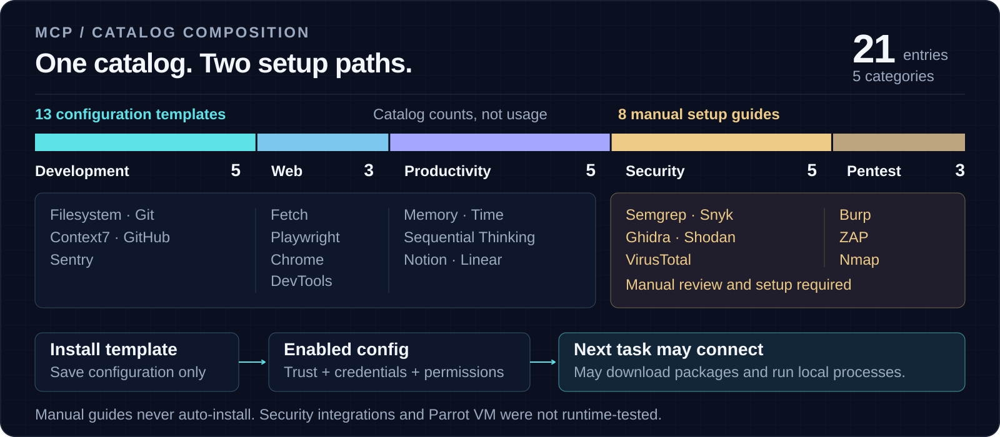

<a id="34-mcp-catalog-security-and-parrot-os"></a>
<details>
<summary><strong>MCP catalog · 3.4</strong> · Enabled servers may run on the next task; Parrot OS is not runtime-tested</summary>

### MCP catalog, security and Parrot OS

The MCP tab now includes a curated catalog with searchable Development, Web, Productivity, Security and Pentest categories. Each entry links to upstream documentation and explains its runtime requirements, use case, setup caveats and source-check date. This is a selection of useful integrations, not a measured popularity ranking or a security audit.

- **Configuration templates:** Project / Global buttons collect parameters in native IDE prompts. Tokens are entered in password inputs and stored in VS Code SecretStorage; JSON files contain only `${ENV_VAR}` references. The binding includes the exact config and file, so another server or an edited command/URL cannot silently reuse the saved token. CLI runs supply their own environment variables, not IDE credentials.
- **Setup guides:** Native tools, plugins and integrations requiring additional setup are explicitly labelled Setup guide. They are not presented as one-click installations.
- **Security / Pentest:** Dedicated entries describe code and dependency checks, threat intelligence, web testing, network inventory and reverse engineering. Read the [Security MCP and Parrot OS guide](docs/MCP-SECURITY-PARROT.md) for prerequisites, exact upstream examples and where each tool is useful.
- **No execution during installation:** Installing a catalog template saves an enabled config only. It does not download software, start a process, scan a target or add permission rules. Your next task can connect enabled servers and download/run the declared npm/uv package, subject to the existing workspace trust guard for project stdio servers. Existing server names are not overwritten.

```bash
pcode mcp catalog                   # all entries, requirements and documentation
pcode mcp catalog security
pcode mcp catalog pentest
pcode mcp install context7 -s user  # adds configuration only
pcode mcp install filesystem --set DIRECTORY=/absolute/path/to/allowed/files
```

Catalog tokens must come from the environment, never `--set`, `--env` or `--header` on `mcp install`. Use the manual `pcode mcp add` command after completing a native tool's setup guide. Security tools should run as an ordinary user in a lab or on explicitly authorised targets; Parrot OS compatibility is documented as prerequisites and upstream Linux support, not a claim of VM testing.

[`.env.example`](.env.example) lists the supported token variable names. PerplexiCode does not automatically load dotenv files: export the needed variables in your CLI environment, or use the IDE's native password prompts. Populated `.env` files are excluded from Git and VSIX packaging.

</details>

<a id="33-mcp-servers-and-compute-modes"></a>
<a id="mcp-servers"></a>
<a id="compute-modes"></a>
<a id="new-tools-in-33"></a>
<details>
<summary><strong>MCP & compute · 3.3</strong> · Configuration, trust, permissions and execution modes</summary>

### MCP servers

PerplexiCode speaks the [Model Context Protocol](https://modelcontextprotocol.io) the way Claude Code does, so an existing `.mcp.json` or `~/.claude.json` works without changes.

| | |
| --- | --- |
| **Config files** | `~/.claude.json` (root and `projects[<folder>]`), `~/.claude/.mcp.json`, `~/.perplexicode/mcp.json`, the `mcpServers` block of any settings file, `<project>/.mcp.json`, `.claude/.mcp.json`, `.perplexicode/mcp.json`, `.mcp.local.json` and `*.local.json`. Later files override earlier ones by server name. `${VAR}` and `${VAR:-default}` are expanded in `command`, `args`, `env`, `url` and `headers`. |
| **Transports** | `stdio` (`command` + `args`), `http` (Streamable HTTP) and `sse`, with custom `headers`. Server-initiated `ping` and `roots/list` are answered and `tools/list_changed` refreshes the tool list. |
| **Trust** | stdio servers from the project or `.local.json` start only in a trusted workspace (Workspace Trust in VS Code, `--trust-project` in the CLI). User-level and HTTP servers always start. Untrusted servers are listed with the reason. |
| **Agent tools** | `use_mcp_tool`, `access_mcp_resource`, `list_mcp_resources`, or a direct `<mcp__server__tool>{"arg": 1}</mcp__server__tool>` call. Connected server prompts appear in the IDE `/` popup and CLI REPL as `/<server>:<skill> [key="val"]`. |
| **OAuth 2.0 + PKCE** | `pcode mcp login <server>` and `pcode mcp logout <server>` (or **OAuth Login** / **OAuth Logout** in **Library → MCP**) run loopback OAuth 2.0 + PKCE S256 with RFC 8414 / 9728 metadata discovery, storing tokens in VS Code `SecretStorage` (IDE) or the OS keychain (CLI) and refreshing automatically on HTTP `401`. |
| **Permissions** | Rules `mcp__server__tool`, `mcp__server__tool(key:glob)` / `mcp__server__tool({"nested":{"field":"glob"}})`, `mcp__server__read_resource(uri:glob)`, `mcp__server__*`, `mcp__server`, `mcp` and `mcp(server)` in `allow` / `ask` / `deny`. `deny` rules always win — even when `autoApprove.mcp` or `bypassPermissions` is enabled — and fail closed on malformed JSON arguments. |
| **VS Code** | **Library → MCP** tab (status, tools, resources, prompts, OAuth Login/Logout, add / remove / reconnect, open the config file), `/mcp` and `/server:skill` in the composer, **PerplexiCode: MCP: Reconnect Servers**, **MCP: OAuth Login to Server…**, **MCP: OAuth Logout from Server…**, settings `perplexicodeKilo.mcp.enabled` and `perplexicodeKilo.mcp.extraConfigs`. |
| **CLI** | `pcode mcp list \| add \| remove \| get \| test \| login \| logout`, `--mcp-config <file\|json>` (repeatable), `--strict-mcp-config`, `--no-mcp`, REPL `/mcp [reconnect [name]]` and `/<server>:<skill>`. `pcode doctor` shows the servers. |

```bash
# Supply GITHUB_PERSONAL_ACCESS_TOKEN through your environment before connecting.
pcode mcp install github -s user    # official remote service; saves enabled config only
pcode mcp add docs -t http -H 'Authorization: Bearer ${DOCS_TOKEN}' -- https://mcp.example.com/mcp
pcode mcp list                       # name, type, scope, enabled/untrusted, target, config file
pcode mcp get github                 # connects and lists tools and resources
pcode -p "list open issues labelled bug" --allowedTools "mcp__github__list_issues"
pcode -p "summarise README" --mcp-config ./ci-mcp.json --strict-mcp-config
```

```jsonc
// .mcp.json (project) — the Claude Code format
{
  "mcpServers": {
    "filesystem": { "command": "npx", "args": ["-y", "@modelcontextprotocol/server-filesystem", "."] },
    "docs": { "type": "http", "url": "https://mcp.example.com/mcp", "headers": { "Authorization": "Bearer ${DOCS_TOKEN}" } }
  }
}
```

### Compute modes

A compute mode decides how Perplexity runs the request; the model picker still decides which model answers in Search mode.

| Mode | What runs | Plan |
| --- | --- | :---: |
| `search` (default) | Standard query with the selected model, optional Thinking and web search | Free |
| `light` · `standard` · `high` · `ultra` | Perplexity Computer harness with Claude Sonnet 5.5 · Claude Opus 5.5 · GPT-6.2 Astra · Claude Fable 5.2 (Ultra uses high effort) | **Max** |
| `computer` | Computer (ASI) with the ASI variant of the selected model | **Max** |
| `research` | Deep Research | Pro |
| `agentic_research` | Agentic research synthesis | **Max** |
| `labs` | Labs / Studio for files, apps and structured artifacts | Pro |

If a mode is not available for your accounts or its quota is exhausted, the request falls back along a chain (Computer harness → Comet browser agent → Search with the closest chat model; Deep Research → Best) and the task log says which mode was actually used.

- **VS Code**: the compute pill next to the model picker, **PerplexiCode: Select Compute Mode**, setting `perplexicodeKilo.computeMode` (default `search`); the status bar shows the active mode.
- **CLI**: `pcode --compute ultra -p "…"`, REPL `/compute [mode]`, `pcode models` lists the modes, and `computeMode` in `.perplexicode/settings.json` sets a per-project default.

### Additional tools

`glob_files` (gitignore-style patterns inside the workspace), `search_and_replace` (literal or regex, optional line range) and `web_fetch` (HTTP(S) GET with redirects, size limit and HTML → text; rules `WebFetch(domain:docs.example.com)` and the **Web** auto-approve toggle).

</details>

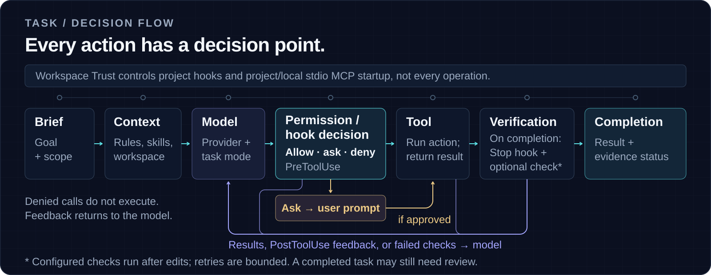

<a id="30-headless-core--pcode-cli"></a>
<details>
<summary><strong>Headless core & pcode CLI</strong> · Permissions, hooks, verification and resumable sessions</summary>

The extension and a terminal CLI share one agent core, so you get Kilo Code in the editor and Claude Code in the terminal from one install.

| | |
| --- | --- |
| **`pcode` CLI** | REPL with diff approvals and slash commands (`/mode`, `/permissions`, `/compact`, `/resume` …). Headless `pcode -p "…"` with `--output-format text\|json\|stream-json` for scripts and CI. |
| **Claude Code compatible config** | Reads `.claude/settings.json` (permissions and hooks), `.claude/agents/*.md`, skills and `CLAUDE.md`. Your existing `.claude/` folder works as is, next to `.perplexicode/`. |
| **Permissions** | `allow` / `ask` / `deny` rules such as `Bash(npm test:*)` and `Edit(src/**)`. Modes `default`, `acceptEdits`, `plan` and `bypassPermissions`. Built-in protection for `.env`, keys and `.ssh`, including through symlinks and `cat .env`. |
| **Hooks** | `PreToolUse`, `PostToolUse`, `UserPromptSubmit`, `Stop`, `SubagentStop`, `SessionStart`, `SessionEnd`. Exit code 2 blocks the action. JSON decisions are supported. Project hooks run only in trusted folders. |
| **Verify before done** | `verify.command` (for example `npm test`) runs before the task can finish, and a failing check sends the agent back to fix it. Each task ends with a status: verified, needs review, failed, blocked or no changes. |
| **Subagents** | `new_task` can delegate to your own agents. Each one has its own prompt, model and tool list, and the tool list is enforced. |
| **Resume anywhere** | Every IDE or CLI task writes a journal to `~/.perplexicode/sessions`. `pcode -c` continues the last one. Commands that were cut off by a crash are flagged, and the agent checks the real state before re-running them. |
| **Fewer round-trips** | Up to 5 read-only tool calls from one answer run in one step. |
| **Worktrees** (3.7) | `pcode -w [name]` runs the task in an isolated git worktree; `pcode worktree list \| apply <name> \| discard <name>` brings the result back or drops it. |
| **Daemon** (4.0) | `pcode serve` exposes the core over a Unix socket or WebSocket for the IDE — see [Remote core](#40-remote-core-lsp-repl--quick-edit). |
| **REPL extras** (3.6 – 4.0) | `!<command>`, `/rewind [list\|n]`, `/context`, `/worktree`, `/<server>:<prompt>` and a live timer for long commands. |
| **Two transports** | Your Perplexity Pro/Max web session, with account rotation (shared with the extension through **PerplexiCode: Share Accounts with CLI** or `pcode login`), or any OpenAI-compatible endpoint (`--provider openai`: Ollama, LM Studio, vLLM). |

```bash
git clone https://github.com/MRX7999/PerplexiCode-Kilo && cd PerplexiCode-Kilo
npm ci && npm run build && npm link          # puts `pcode` on PATH
pcode login                                  # paste the Cookie header (hidden input) or use --browser
pcode doctor
pcode -p "fix the failing test" --permission-mode acceptEdits --allowedTools "Bash(npm test:*)"
pcode -w -p "migrate to the new API" --cross-review    # isolated worktree + cross-model review
pcode worktree apply <name>                             # copy the result into your checkout
pcode models update                                     # refresh the model list (SHA-256 verified)
pcode doctor --bundle -o diag.json                      # redacted diagnostics for an issue
```

Exit codes of `pcode -p`, stable for CI:

| Code | Meaning |
| :---: | --- |
| `0` | Done |
| `1` | Runtime error |
| `2` | `verify.command` failed |
| `3` | Blocked by a rule, a hook or `--stop-on-fallback` |
| `4` | `--max-turns` reached |
| `5` | Not signed in |
| `6` | Worktree apply conflict |
| `64` | Invalid arguments (including a secret passed as an argument) |
| `130` | Interrupted (`Ctrl+C`) |

Other flags added in 3.5 – 4.0: `--stop-on-fallback`, `--repo-map` / `--no-repo-map`, `--repo-map-chars <n>`, `--max-rpm <n>`, `--max-parallel-subtasks <n>`, `--cross-review`, `--cross-review-model <id>`. Full list: `pcode --help`.

See [docs/CORE-3.0.md](docs/CORE-3.0.md) for the full reference and [examples/claude-code-compat](examples/claude-code-compat) for a working configuration.

</details>

<a id="models"></a>
<details>
<summary><strong>Models</strong> · Account discovery, fallback catalog and subscription handling</summary>

The model list matches the current Perplexity picker. It is loaded live from your account's model config, with a bundled snapshot (2026-11-27, 133 models) as a fallback.

| Model | Provider | Plan | Thinking |
| --- | --- | :---: | :---: |
| Best | Perplexity | Free | — |
| GPT-6.2 Sol `NEW` | OpenAI | Pro | ✓ |
| GPT-6.2 Astra `NEW` | OpenAI | **Max** | ✓ |
| Gemini 4 Carbon | Google | **Max** | ✓ |
| Gemini 4 Neon `NEW` | Google | Pro | ✓ |
| Claude Sonnet 5.5 | Anthropic | Pro | ✓ |
| Claude Opus 5.5 | Anthropic | **Max** | ✓ |
| Claude Fable 5.2 | Anthropic | **Max** | ✓ |
| Kimi K3 | Moonshot AI | Pro | built-in |
| GLM 5.3 | Z.ai | Pro | built-in |
| Grok 4.7 | xAI | Pro | ✓ |
| Nemotron 3.5 Super VL | NVIDIA | Pro | — |
| **More models** (121) | Anthropic, OpenAI, Google, xAI, Perplexity Sonar… | Pro / Max | per model |

<table>
  <tr>
    <td align="center"><br /><sub>Featured models</sub></td>
    <td align="center">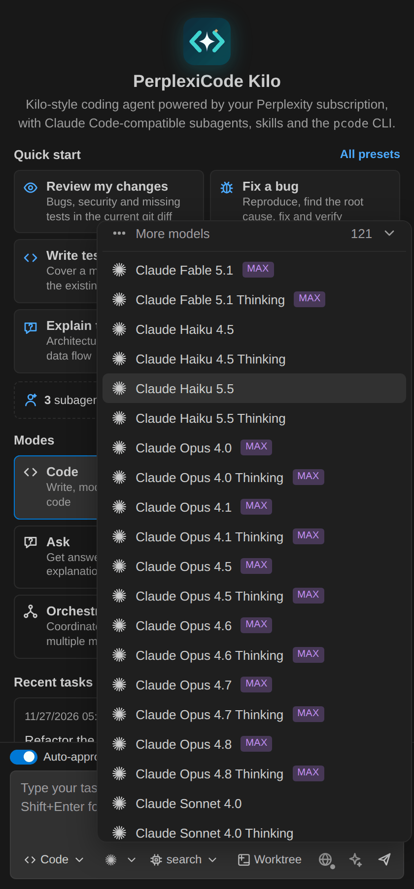<br /><sub>More models</sub></td>
  </tr>
</table>

When Perplexity adds models between releases, run `pcode models update` or **PerplexiCode: Update Model Catalog from Repository**: the new list is applied only if its SHA-256 matches, otherwise the bundled snapshot stays in use.

Max models unlock automatically for Max accounts. If a Max model is picked on a Pro-only account pool, the request falls back to **Best**. Override plan detection with `perplexicodeKilo.subscriptionPlan` if needed, and use **PerplexiCode: Refresh Models and Quotas** after Perplexity adds new models.

</details>

<a id="commands-and-shortcuts"></a>
<details>
<summary><strong>Commands & shortcuts</strong> · Editor actions and keyboard reference</summary>

| Command | macOS | Windows / Linux |
| --- | --- | --- |
| PerplexiCode: Open Agent | `Cmd+Alt+K` | `Ctrl+Alt+K` |
| PerplexiCode: New Task | `Cmd+Alt+N` | `Ctrl+Alt+N` |
| PerplexiCode: Switch to Next Mode | `Cmd+.` | `Ctrl+.` |
| PerplexiCode: Quick Edit Selection | `Cmd+I` | `Ctrl+I` |
| PerplexiCode: Add Selection to Chat | `Cmd+Shift+I` | `Ctrl+Shift+I` |
| PerplexiCode: Add to Context | `Cmd+K Cmd+A` | `Ctrl+K Ctrl+A` |
| PerplexiCode: Explain / Fix / Improve Code | context menu, lightbulb | context menu, lightbulb |
| PerplexiCode: Explain Current File | Command Palette | Command Palette |
| PerplexiCode: Add Terminal Selection to Context | terminal context menu | terminal context menu |
| PerplexiCode: Generate Commit Message | Source Control title bar | Source Control title bar |
| PerplexiCode: Select Model / Mode / Compute Mode | status bar | status bar |
| PerplexiCode: Inspect Task Context… | task header / `/context` / Command Palette | task header / `/context` / Command Palette |
| PerplexiCode: Copy Diagnostics Bundle… | task header / Command Palette | task header / Command Palette |
| PerplexiCode: MCP: Reconnect Servers · OAuth Login to Server… · OAuth Logout from Server… | Command Palette, Library → MCP | Command Palette, Library → MCP |
| PerplexiCode: Remote Core: Connect to pcode serve… · Disconnect | Command Palette | Command Palette |
| PerplexiCode: Update Model Catalog from Repository | Command Palette | Command Palette |
| PerplexiCode: Compact Current Task · Set Permission Mode | Command Palette | Command Palette |
| PerplexiCode: Share Accounts with CLI (pcode) | Command Palette | Command Palette |
| PerplexiCode: Task History · Settings · Open in Editor Tab | view title bar | view title bar |
| PerplexiCode: Add / Manage Accounts · Set Account Rotation Strategy · Refresh Models and Quotas | Command Palette | Command Palette |

</details>

<a id="settings"></a>
<details>
<summary><strong>Settings</strong> · All defaults, approval controls and context limits</summary>

| Setting | Default | Description |
| --- | --- | --- |
| `perplexicodeKilo.defaultModel` | `turbo` (Best) | Model for new tasks. |
| `perplexicodeKilo.subscriptionPlan` | `auto` | Force `pro` or `max` when detection is wrong. |
| `perplexicodeKilo.computeMode` | `search` | Default compute mode: `search`, `light`, `standard`, `high`, `ultra`, `research`, `agentic_research`, `labs`. |
| `perplexicodeKilo.mcp.enabled` | `true` | Connect to configured MCP servers. |
| `perplexicodeKilo.mcp.extraConfigs` | `[]` | Extra MCP config files or inline JSON, like `pcode --mcp-config`. |
| `perplexicodeKilo.agent.autoApprove.enabled` | `true` | Master switch for auto-approval. |
| `perplexicodeKilo.agent.autoApprove.read` | `true` | Reading, listing and searching inside the workspace. |
| `perplexicodeKilo.agent.autoApprove.readOutsideWorkspace` | `false` | Reads outside the workspace. |
| `perplexicodeKilo.agent.autoApprove.write` | `false` | Creating and editing files. |
| `perplexicodeKilo.agent.autoApprove.execute` | `false` | Commands matching `allowedCommands`. |
| `perplexicodeKilo.agent.autoApprove.modeSwitch` | `true` | Mode switches requested by the agent. |
| `perplexicodeKilo.agent.autoApprove.subtasks` | `true` | Orchestrator subtasks. |
| `perplexicodeKilo.agent.autoApprove.todo` | `true` | Todo list updates. |
| `perplexicodeKilo.agent.autoApprove.retry` | `true` | Retry failed Perplexity requests. |
| `perplexicodeKilo.agent.autoApprove.mcp` | `false` | MCP tool calls and resource reads (permission rules still apply). |
| `perplexicodeKilo.agent.autoApprove.web` | `false` | `web_fetch` requests (`WebFetch(domain:…)` rules still apply). |
| `perplexicodeKilo.agent.allowedCommands` | `npm test`, `npm run`, `git status`, `git diff`, `git log`, `ls`, `cat`, `pwd` | Command prefixes that may run without approval (`*` = all). |
| `perplexicodeKilo.agent.deniedCommands` | `rm -rf`, `sudo`, `git push --force` | Prefixes that always need approval. |
| `perplexicodeKilo.agent.maxRequestsPerTask` | `40` | Ask before continuing after this many requests. |
| `perplexicodeKilo.agent.maxReadFileLines` | `500` | Lines per `read_file` call. |
| `perplexicodeKilo.agent.commandTimeoutSeconds` | `120` | Command timeout, `0` = none. |
| `perplexicodeKilo.agent.terminalOutputLineLimit` | `300` | Terminal lines sent to the model. |
| `perplexicodeKilo.agent.webSearch` | `auto` | Whether Perplexity may search the web for agent requests. |
| `perplexicodeKilo.agent.contextStrategy` | `auto` | Thread follow-ups or full self-contained prompts. |
| `perplexicodeKilo.agent.maxPromptChars` | `60000` | Prompt size limit; older turns are condensed. |
| `perplexicodeKilo.agent.permissionMode` | `default` | `default`, `acceptEdits`, `plan` or `bypassPermissions` — same rules as `pcode --permission-mode`. |
| `perplexicodeKilo.agent.hooks.enabled` | `true` | Run hooks from `.claude/settings.json` / `.perplexicode/settings.json` (project hooks need a trusted workspace). |
| `perplexicodeKilo.agent.journal.enabled` | `true` | Write the session journal to `~/.perplexicode/sessions` so tasks can be resumed from the CLI. |
| `perplexicodeKilo.agent.readBatchSize` | `0` | Read-only tool calls run in one step; `0` uses the settings-file value (5). |
| `perplexicodeKilo.agent.worktreeEnabled` | `false` | Run tasks inside an isolated git worktree from `HEAD` with strict symlink and `git -C` confinement. |
| `perplexicodeKilo.agent.maxParallelSubtasks` | `3` | Maximum concurrent subagents in Orchestrator mode (readers in main tree, writers in isolated worktrees). |
| `perplexicodeKilo.agent.repoMapEnabled` | `true` | Include the structural `@repo` map (symbols, signatures, imports, related tests) within budget. |
| `perplexicodeKilo.agent.repoMapMaxChars` | `6000` | Hard character ceiling for `@repo`. |
| `perplexicodeKilo.agent.autoCompactThreshold` | `0.8` | Fraction of `maxPromptChars` triggering structured auto-compaction (`0` disables). |
| `perplexicodeKilo.agent.autoCompactKeepSteps` | `4` | Latest dialogue steps kept untouched during auto-compaction. |
| `perplexicodeKilo.agent.stopOnFallback` | `false` | Stop the task instead of falling back to another compute mode, model or account. |
| `perplexicodeKilo.agent.crossModelReview` | `false` | Run an independent review of the git diff and `verify` status using a model from a different family before `attempt_completion`. |
| `perplexicodeKilo.agent.crossModelReviewModel` | `""` | Optional preferred reviewer model ID for cross-model review (empty auto-selects another model family). |
| `perplexicodeKilo.rotation.maxRequestsPerMinute` | `12` | Conservative per-account RPM cap before rotating or throttling. |
| `perplexicodeKilo.agent.language` | `auto` | Reply language, e.g. `en`, `ru`. |
| `perplexicodeKilo.agent.customInstructions` | — | Instructions added to every mode. |
| `perplexicodeKilo.agent.modeInstructions` | `{}` | Per-mode instructions keyed by mode slug. |
| `perplexicodeKilo.agent.diffEnabled` | `true` | Use `apply_diff` instead of full rewrites. |
| `perplexicodeKilo.agent.includeFileListOnStart` | `true` | Send the workspace file list with the first request. |
| `perplexicodeKilo.agent.revealEditedFiles` | `true` | Open files after the agent edits them. |
| `perplexicodeKilo.taskPresets` | `[]` | Your own task presets. |
| `perplexicodeKilo.excludePatterns` | `node_modules`, `.git`, `dist`, `out`, `.next` | Globs excluded from context. |
| `perplexicodeKilo.remote.url` | `""` | Remote `pcode serve` endpoint (`unix:///path/to/serve.sock` or `ws://127.0.0.1:4190`); bearer token is kept in OS `SecretStorage` and Perplexity cookies never leave the IDE machine. |
| `perplexicodeKilo.models.remoteCatalogUrl` | `""` | Custom repository URL for SHA-256 verified `bundledModelsConfig.json` updates (empty uses the official `MRX7999/PerplexiCode-Kilo` URL; built-in snapshot stays fallback). |
| `perplexicodeKilo.models.remoteCatalogSha256Url` | `""` | Custom URL for `bundledModelsConfig.json.sha256` digest verification. |

</details>

<a id="migrating-to-40"></a>
<a id="миграция-на-40"></a>
<details open>
<summary><strong>Migrating to 4.0</strong> · Eleven behaviour changes since 3.4 · no settings renamed</summary>

## Migrating to 4.0

Every `perplexicodeKilo.*` setting keeps its name, saved accounts stay in SecretStorage, and Claude Code configs (`.claude/settings.json`, hooks, agents, skills, `.mcp.json`) keep working unchanged. These are all the incompatible or behaviour changes between `3.4.0` and `4.0.0`:

| # | Change | What to do |
| :---: | --- | --- |
| 1 | **No secrets in CLI arguments.** `pcode login`, `pcode mcp install` and `pcode serve` refuse `--token` and other secrets passed as arguments with exit code `64`. | Use environment variables (`PPLX_COOKIE`, `PCODE_SERVE_TOKEN`), `--token-env`, `--token-stdin`, the hidden prompt or `~/.perplexicode/serve.token` (`0600`). |
| 2 | **Shell commands are checked per segment.** Chains (`;`, `&&`, `\|\|`, `\|`, `&`, new lines), `env VAR=…` wrappers and `sh -c` / `bash -c` / `zsh -c` scripts are split, and every segment must pass `allow` / `deny` on its own. `$(…)`, backticks, `eval` and redirections (`>`, `>>`, `<`) always ask. | Allow rules that relied on the first command's prefix may now prompt — add rules for the other segments. |
| 3 | **Agent config edits always ask.** Writing or deleting `.perplexicode/settings*.json`, hook scripts, `.mcp.json`, `.lsp.json` and anything under `.claude/**` needs your confirmation, even with `autoApprove.write`, `acceptEdits` or `bypassPermissions`. | Nothing to change; expect a prompt for these files. |
| 4 | **`web_fetch` blocks local and private addresses.** Loopback (`127.0.0.0/8`, `::1`), RFC 1918 (`10/8`, `172.16/12`, `192.168/16`), link-local and cloud metadata (`169.254/16`, `fe80::/10`), CGNAT, ULA and `.localhost` / `.internal` are refused, including after redirects. | Reach local services through an explicit MCP server. |
| 5 | **Safe resume after a crash.** A command cut off before its exit code was recorded (`command_unconfirmed`) cannot be re-run blindly after `pcode --continue` / `--resume` or reopening the task. | The agent first inspects the workspace with `read_file`, `list_files` or `search_files`. |
| 6 | **MCP argument rules beat auto-approve.** `permissions.deny` / `ask` with argument predicates (for example `mcp__db__query(sql:*DROP*)`) win over `autoApprove.mcp: true`; malformed JSON arguments are blocked when such a `deny` rule exists. | Review `deny` rules that used to be bypassed by auto-approve. |
| 7 | **Worktrees never merge on their own.** `--worktree` / `worktreeEnabled` tasks and writing Orchestrator subagents run in separate git worktrees with no automatic `merge`, `commit` or `push`. | Bring results back with **Apply** or `pcode worktree apply <name>`; a conflict leaves your tree untouched and the CLI exits with `6`. |
| 8 | **Fixed exit codes for `pcode -p`.** `0` done, `1` runtime error, `2` `verify.command` failed, `3` blocked by a rule / hook / `stopOnFallback`, `4` `--max-turns` reached, `5` not signed in, `6` worktree conflict, `64` invalid arguments, `130` interrupted. | CI scripts that compared against `1` only should check for non-zero or the specific code. |
| 9 | **12 requests per minute per account, optional hard stop on fallback.** `perplexicodeKilo.rotation.maxRequestsPerMinute` defaults to `12`. With `perplexicodeKilo.agent.stopOnFallback: true` (`--stop-on-fallback`) the task stops with *needs you* instead of switching mode or model. `council` mode is not offered because it is not in `bundledModelsConfig.json`. | Raise the RPM cap if you run many accounts; turn on `stopOnFallback` if a silent model switch is unacceptable. |
| 10 | **`pcode serve` security boundary.** The daemon never stores or accepts cookies, `csrfToken` or `sessionToken`; model calls go back to the IDE through `llm/complete`, and any message with session fields is rejected (`RemoteSecurityViolationError`). Project `.lsp.json` servers start only in trusted folders. | Use `--trust-project` for project LSP and hooks on the daemon. |
| 11 | **`Cmd/Ctrl+I` opens Quick Edit.** With a selection in an editable file, `Cmd+I` (macOS) / `Ctrl+I` (Windows, Linux) runs `perplexicodeKilo.quickEditSelection`. | **Add Selection to Chat** (`perplexicodeKilo.askAboutSelection`) is on `Cmd/Ctrl+Shift+I`; rebind in Keyboard Shortcuts if you prefer the old key. |

</details>

<a id="build-from-source"></a>
<a id="project-layout"></a>
<details>
<summary><strong>Build & project layout</strong> · Local checks, packaging and release workflow</summary>

Requirements: [Node.js](https://nodejs.org/) 20+ and npm.

```bash
git clone https://github.com/MRX7999/PerplexiCode-Kilo.git
cd PerplexiCode-Kilo
npm ci
npm run lint                                   # extension + webview type check
npm test                                       # parser, diff engine, tools, models, agent loop, transport
npx vsce package --out perplexicode-kilo.vsix  # build the VSIX
```

`npm run test:webview` renders the webview in headless Chromium and saves screenshots to `out/test/` (needs a [Playwright](https://playwright.dev/) Chromium in `~/.cache/ms-playwright`).

Releases are built by [GitHub Actions](.github/workflows/release.yml): pushing a `vX.Y.Z` tag that matches `package.json` runs lint and tests, packages the VSIX, attaches it with `SHA256SUMS.txt` to a GitHub release and publishes it to Open VSX and the VS Code Marketplace. [`canary.yml`](.github/workflows/canary.yml) checks the Perplexity protocol every night.

### Project layout

```text
src/
  extension.ts          activation, commands, code actions, webview providers
  agent/                agent loop, modes, prompts, tool parser and executor, diff engine, transport, task store
  api/                  Perplexity client, model catalog, bundled model config (+ .sha256), quotas, account rotation
  core/                 headless agent core shared by the IDE, the CLI and pcode serve (permissions, hooks, LSP, worktrees, repo map)
  cli/                  pcode CLI, REPL and serve daemon
  config/ · migration/  settings loading and 1.x / 2.x migration
  providers/            login flows
  storage/              account manager (SecretStorage)
  ui/                   status bar
webview-ui/agent/       chat UI (TypeScript + CSS, bundled with esbuild)
test/                   unit and agent tests, webview render harness
scripts/                install.sh, install.ps1 (SHA-256 verified)
docs/                   CORE-3.0.md, screenshots and diagrams
.github/workflows/      CI, release and nightly canary
```

</details>

<a id="troubleshooting"></a>
<details>
<summary><strong>Troubleshooting</strong> · Authentication, installation and task recovery</summary>

| Problem | Fix |
| --- | --- |
| Max models are locked on a Max account | Run **Refresh Models and Quotas**, or set `perplexicodeKilo.subscriptionPlan` to `max`. |
| `401` / session expired | **Manage Accounts** → refresh session, or add the account again. |
| The CLI says `NOT registered` | Harmless Antigravity warning; check `--list-extensions --show-versions`. |
| Install script cannot find the editor | Pass `--vsix` with a downloaded file, or use **Install from VSIX…**. |
| Agent stops after many steps | Raise `perplexicodeKilo.agent.maxRequestsPerTask`. |
| Task sits at *0 requests* with no folder open | Open a project folder. Since 4.0.2 a task in the home directory skips the start-up file list and the `@repo` map, so it no longer stalls on `~/Library` or iCloud folders. |
| `Connection timed out` / `Connection failed: could not connect to www.perplexity.ai` | Your machine cannot reach `www.perplexity.ai` over TCP. Check with `curl -sv -m 20 -o /dev/null https://www.perplexity.ai/`, then your VPN, proxy or router exclusions. Since 4.0.2 network errors no longer mark the account as failed, so you will not see *No active Perplexity account* afterwards. |
| Task stopped with *needs you* after a fallback | `stopOnFallback` is on and the requested mode or model is not available for your accounts. Pick another one or turn the setting off. |
| `pcode` exits with code `64` | A secret was passed as an argument (for example `--token`). Use `PCODE_SERVE_TOKEN`, `--token-env`, `--token-stdin` or the hidden prompt. |
| `lsp` says *No LSP servers configured* (CLI) | Add the server to `.lsp.json` or `~/.perplexicode/lsp.json`; project files also need `--trust-project`. |
| Catalog update says the hash does not match | Nothing changed — the bundled snapshot is still used. Check `remoteCatalogUrl` / `remoteCatalogSha256Url` point to the same commit. |
| Remote Core cannot connect | Check the endpoint and token (`~/.perplexicode/serve.token`), and that the socket or SSH tunnel exists. The IDE stays in local mode until it connects. |
| Something else | `pcode doctor --bundle` or **Copy Diagnostics Bundle…** — attach the redacted file to an issue. |
| `Unable to write to User Settings … is not a registered configuration` | The extension was updated while the window stayed open. Run **Developer: Reload Window**. Since 2.1.0 the change is saved anyway and moved into settings after the reload. |
| Anything else | Open **Output → PerplexiCode** and attach the log to an [issue](https://github.com/MRX7999/PerplexiCode-Kilo/issues). |

</details>

<a id="credits"></a>
<a id="disclaimer"></a>
<a id="license"></a>
<details>
<summary><strong>Credits, disclaimer & license</strong> · Unofficial community project, subscription limits and MIT terms</summary>

### Credits

- Original extension: [yuki-20/PerplexiCode](https://github.com/yuki-20/PerplexiCode) (MIT).
- Agent design, modes and tool protocol follow [Kilo Code](https://github.com/Kilo-Org/kilocode), itself based on [Roo Code](https://github.com/RooCodeInc/Roo-Code) and [Cline](https://github.com/cline/cline).

### Disclaimer

PerplexiCode is an unofficial community project and is not affiliated with or endorsed by Perplexity AI, Kilo Code or Google. It uses your own Perplexity web session; usage counts against your subscription limits and is subject to the [Perplexity Terms of Service](https://www.perplexity.ai/hub/legal/terms-of-service).

### License

[MIT](LICENSE). Original work © yuki-20; PerplexiCode Kilo changes © MRX7999.

</details>
