<div align="center">

# PerplexiCode Kilo

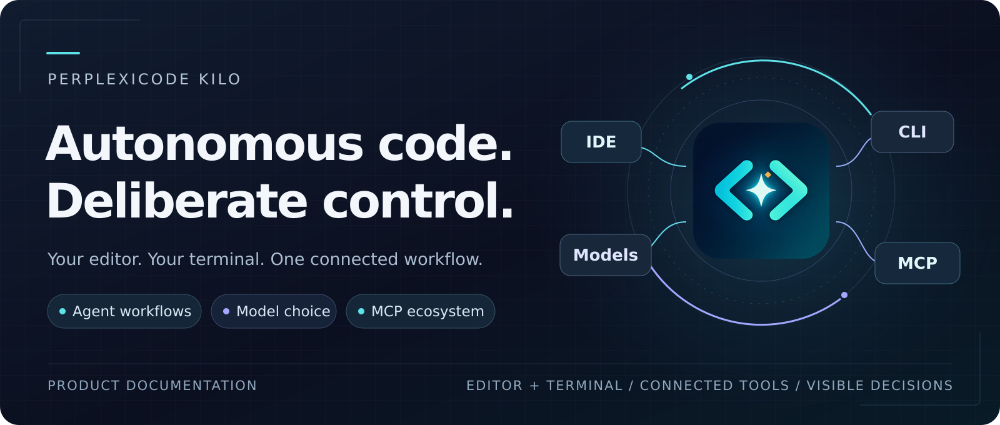

[](https://github.com/MRX7999/PerplexiCode-Kilo/releases/latest)
[](https://marketplace.visualstudio.com/items?itemName=MRX7999.perplexicode-kilo)
[](https://open-vsx.org/extension/MRX7999/perplexicode-kilo)
[](https://open-vsx.org/extension/MRX7999/perplexicode-kilo)
[](https://github.com/MRX7999/PerplexiCode-Kilo/actions/workflows/ci.yml)
[](https://github.com/MRX7999/PerplexiCode-Kilo/releases)
[](https://code.visualstudio.com/)
[](https://antigravity.google/download)
[](LICENSE)

[Overview](#features) · [Install](#install) · [Interface & agents](#31-agents-skills--presets) · [MCP catalog](#34-mcp-catalog-security-and-parrot-os) · [MCP & compute](#33-mcp-servers-and-compute-modes) · [CLI](#30-headless-core--pcode-cli) · [Models](#models) · [Commands](#commands-and-shortcuts) · [Settings](#settings) · [Build](#build-from-source) · [Help](#troubleshooting)

[Core reference](docs/CORE-3.0.md) · [Security & Parrot OS guide](docs/MCP-SECURITY-PARROT.md)

</div>

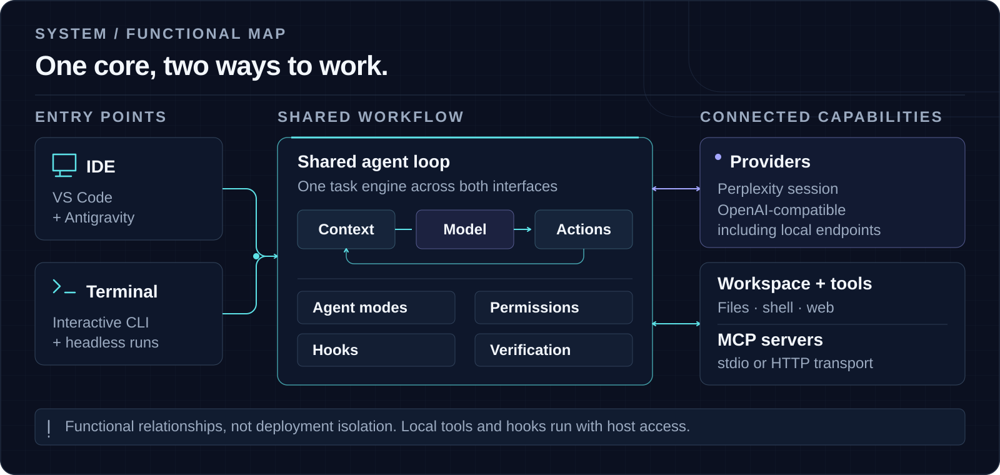

<a id="features"></a>
<a id="modes"></a>
<a id="how-it-works"></a>
<details>
<summary><strong>Overview</strong> · Capabilities, modes and the shared agent loop</summary>

### Features

**A Kilo Code-style autonomous coding agent for Antigravity IDE and VS Code, powered by your Perplexity Pro / Max subscription.**

Plan, write, run and debug code with GPT-6.1 Sol, Claude Opus 5.5, Gemini 4 Argon, Grok 4.7 and 85 more Perplexity models. No API keys.

| | |
| --- | --- |
| **Agent loop** | The model works step by step with tools, sees each result and continues until the task is done — the way [Kilo Code](https://github.com/Kilo-Org/kilocode) works. |
| **Six modes** | Code, Architect, Ask, Debug, Orchestrator and Review, each with its own prompt and tool permissions. |
| **Diff approvals** | Every edit is shown as an inline diff with **Save** / **Reject**; commands get **Run** / **Reject**. |
| **Auto-approve** | Separate toggles for reads, writes, commands (allow and deny prefixes), mode switches, subtasks, todo updates and retries, plus a request limit. |
| **Checkpoints** | A checkpoint after every edit with one-click **Restore**. |
| **Context mentions** | `@/path/to/file`, `@/folder/`, `@problems`, `@git-changes`, `@selection`. |
| **Editor actions** | Explain / Fix / Improve / Add to Context from the context menu and lightbulb quick fixes; terminal selection to context. |
| **Workspace rules** | Loads `AGENTS.md`, `.kilocode/rules`, `.roo/rules`, `.clinerules` and `~/.kilocode/rules`. |
| **Task UI** | Todo list with progress, streaming Markdown, reasoning blocks, tool cards, terminal output, follow-up suggestions, prompt enhancer. |
| **History** | Searchable task history; reopen, delete or export past tasks. |
| **Commit messages** | Generates a commit message from staged changes in the Source Control view. |
| **Multi-account** | Several Perplexity accounts with quota display and automatic failover. |
| **MCP servers** (3.3) | Connect Claude Code style MCP servers (stdio, HTTP, SSE) from `.mcp.json`, `~/.claude.json` and settings. Their tools, resources and prompts are available to the agent with `mcp__server__tool` permission rules. See [3.3](#33-mcp-servers-and-compute-modes). |
| **Compute modes** (3.3) | Pick how Perplexity runs the request: Search, Computer harness (Light / Standard / High / Ultra), Deep Research or Labs, with automatic fallback when your plan does not include a mode. |
| **Agents, Skills & Presets** (3.1) | One-click subagents and skills from a built-in catalog, and task presets that set the mode, subagent and prompt for common jobs. See [below](#31-agents-skills--presets). |
| **`pcode` CLI** (3.0) | The same agent core in the terminal, Claude Code style. See [3.0](#30-headless-core--pcode-cli). |

### Modes

| Mode | Purpose | Tools |
| --- | --- | --- |
| **Code** | Write, modify and refactor code | read, edit, command, modes |
| **Architect** | Plan and design before implementation | read, edit Markdown only, modes |
| **Ask** | Answers and explanations | read |
| **Debug** | Systematic diagnosis and fixes | read, edit, command, modes |
| **Orchestrator** | Split work into subtasks across modes | modes, subtasks |
| **Review** | Review local changes before you commit | read, command, modes |

Agent tools: `read_file`, `list_files`, `search_files`, `glob_files`, `list_code_definition_names`, `apply_diff`, `write_to_file`, `insert_content`, `search_and_replace`, `execute_command`, `web_fetch`, `use_mcp_tool`, `access_mcp_resource`, `list_mcp_resources`, `ask_followup_question`, `attempt_completion`, `switch_mode`, `new_task`, `update_todo_list`.

### How it works

1. You describe a task; PerplexiCode builds a system prompt for the active mode with tool descriptions, workspace rules, the file list and your `@` mentions.
2. The prompt goes to Perplexity through your web session, using the selected model (and Thinking variant, if enabled).
3. The reply is parsed for one XML tool call. Reads run immediately if auto-approved; edits and commands wait for **Save** / **Run** unless auto-approved.
4. The tool result is sent back as the next message, and the loop continues until `attempt_completion`.
5. Perplexity thread follow-ups are used when possible. If a follow-up fails, the full conversation is resent as one prompt, and accounts fail over on quota or auth errors.

</details>

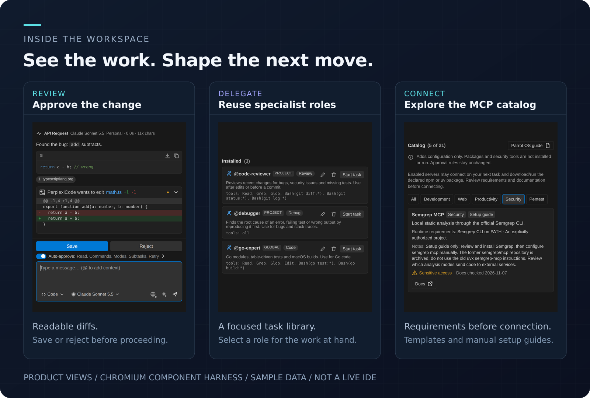

<a id="install"></a>
<a id="from-the-extensions-view"></a>
<a id="one-line-install-from-github-releases"></a>
<a id="manual-install-with-the-antigravity-cli"></a>
<a id="install-from-the-editor-ui"></a>
<a id="after-installing"></a>
<a id="moving-from-perplexicode-1x--20"></a>
<a id="sign-in"></a>
<details>
<summary><strong>Install & sign in</strong> · Editor setup, migration and account storage</summary>

Extension ID: **`MRX7999.perplexicode-kilo`**

### From the Extensions view

VS Code: [Visual Studio Marketplace](https://marketplace.visualstudio.com/items?itemName=MRX7999.perplexicode-kilo) — search for **PerplexiCode Kilo** in the Extensions view or run `code --install-extension MRX7999.perplexicode-kilo`.


Antigravity IDE, Cursor, Windsurf and VSCodium use [Open VSX](https://open-vsx.org/extension/MRX7999/perplexicode-kilo). Open the Extensions view (`Cmd/Ctrl+Shift+X`), search for **PerplexiCode Kilo** and click **Install**, or run:

```bash
antigravity-ide --install-extension MRX7999.perplexicode-kilo
```

### One-line install from GitHub Releases

**macOS / Linux** — installs the latest release into Antigravity IDE:

```bash
curl -fsSL https://raw.githubusercontent.com/MRX7999/PerplexiCode-Kilo/master/scripts/install.sh | bash
```

**Windows (PowerShell):**

```powershell
irm https://raw.githubusercontent.com/MRX7999/PerplexiCode-Kilo/master/scripts/install.ps1 | iex
```

Other editors: add `--ide code`, `--ide cursor`, `--ide windsurf` or `--ide all` (PowerShell: `-Ide code`):

```bash
curl -fsSL https://raw.githubusercontent.com/MRX7999/PerplexiCode-Kilo/master/scripts/install.sh | bash -s -- --ide all
```

The scripts download [`perplexicode-kilo.vsix`](https://github.com/MRX7999/PerplexiCode-Kilo/releases/latest/download/perplexicode-kilo.vsix) from the [latest release](https://github.com/MRX7999/PerplexiCode-Kilo/releases/latest), find the editor CLI on your `PATH` or inside the app bundle, install with `--force` and print the installed version. Read them first: [install.sh](scripts/install.sh), [install.ps1](scripts/install.ps1).

### Manual install with the Antigravity CLI

Download [`perplexicode-kilo.vsix`](https://github.com/MRX7999/PerplexiCode-Kilo/releases/latest/download/perplexicode-kilo.vsix), then:

```bash
# macOS — Antigravity IDE
"/Applications/Antigravity IDE.app/Contents/Resources/app/bin/antigravity-ide" \
  --install-extension ~/Downloads/perplexicode-kilo.vsix --force

# Windows — Antigravity IDE
"%LOCALAPPDATA%\Programs\Antigravity IDE\bin\antigravity-ide.cmd" --install-extension "%USERPROFILE%\Downloads\perplexicode-kilo.vsix" --force

# VS Code / Cursor / Windsurf
code --install-extension perplexicode-kilo.vsix --force
```

The CLI may print `antigravityAnalytics ... NOT registered` — that line is harmless.

### Install from the editor UI

Extensions view (`Cmd/Ctrl+Shift+X`) → `…` menu → **Install from VSIX…** → pick the downloaded file.

### After installing

1. Reload the window: `Cmd/Ctrl+Shift+P` → **Developer: Reload Window**.
2. Open the **PerplexiCode** icon in the activity bar.
3. Sign in (see below) and start a task.

### Moving from PerplexiCode 1.x / 2.0

Since 2.1.0 the extension has its own ID, `MRX7999.perplexicode-kilo` (it was `perplexicode.perplexicode`). Editors keep each extension's secrets separate, so accounts are moved once, with your confirmation:

1. Install PerplexiCode Kilo next to the old extension and reload the window.
2. Click **Import accounts** in the notification. A small bundled helper ([source](bridge/extension.js)) takes over the old ID — it has no UI and makes no network requests.
3. Reload again and confirm **Copy accounts** in the dialog. Sessions, CSRF tokens, cookies and the rotation strategy are copied locally; duplicates are skipped.
4. Click **Uninstall old extension**.

User settings `perplexicode.*` are copied to `perplexicodeKilo.*` automatically. You can rerun the import with **PerplexiCode: Import Accounts from PerplexiCode 1.x**.

### Sign in

Run **PerplexiCode: Add Perplexity Account** and pick one method:

| Method | How it works |
| --- | --- |
| **Import from Browser** (recommended) | Reads your existing `perplexity.ai` session from Chrome, Edge or Brave. |
| **Auto Login** | Opens a browser window, you log in, the session is captured. |
| **Manual Paste** | Paste the full `Cookie` header from DevTools → Network on [perplexity.ai](https://www.perplexity.ai). |

Sessions are kept in the editor's [SecretStorage](https://code.visualstudio.com/api/references/vscode-api#SecretStorage). You can add several accounts; requests are spread across them with **round-robin**, **least-used** or **failover-only** rotation.

</details>

<a id="31-agents-skills--presets"></a>
<a id="screenshots"></a>
<details>
<summary><strong>Interface, agents & skills</strong> · Presets, reusable workflows and screenshot gallery</summary>

### Agents, Skills & Presets

Set up subagents and skills from the UI and start common jobs in one click.

| Where | What you get |
| --- | --- |
| **Welcome screen** | A **Quick start** grid with presets (Review my changes, Fix a bug, Write tests, Build a feature, Explain this project, Security audit). The strip below it shows how many subagents and skills are installed and has **Install starter pack**. |
| **Library button** in the view title (or **PerplexiCode: Agents, Skills & Presets**) | Three tabs. **Task presets**: built-in and your own. **Subagents**: installed ones (open, delete, Start task) and a catalog of 8 (`code-reviewer`, `test-writer`, `debugger`, `security-auditor`, `docs-writer`, `refactorer`, `explorer`, `planner`) that you install into the project or globally. **Skills**: 8 catalog skills (`commit-message`, `code-review-checklist`, `write-tests`, `security-audit`, `debug-playbook`, `api-design`, `release-checklist`, `readme-writer`). Each tab has a form for creating your own items. |
| **Mode menu** | A **Subagents** section: pick `@debugger` and the whole task runs as that subagent, with its prompt and tool list. |
| **Composer** | `/presets`, `/agents`, `/skills` and `/<preset-id>` in the slash menu. The selected preset or agent appears as a chip. |
| **Command palette** | **PerplexiCode: Run Task Preset…**. |

A preset sets the mode, subagent and prompt template (`{{input}}` is replaced with what you type). If the preset needs a subagent or skill that isn't installed, PerplexiCode offers to install it into the project or globally, or to run without it.

Files are standard: subagents go to `.perplexicode/agents/<name>.md` (`~/.perplexicode/agents` for global), skills go to `.perplexicode/skills/<name>/SKILL.md`. Your own presets are stored in `.perplexicode/presets.json`, `~/.perplexicode/presets.json` or the `perplexicodeKilo.taskPresets` setting. Later sources override earlier ones in this order: built-in → global file → setting → project file.

The same actions in the terminal:

```bash
pcode agents catalog                 # list catalog subagents
pcode agents add code-reviewer debugger    # into .perplexicode/agents (-g for global)
pcode skills add commit-message -g
pcode presets                        # list task presets
pcode --preset fix-bug -p "login returns 500"
pcode --agent security-auditor -p "audit src/auth"
```

### Screenshots

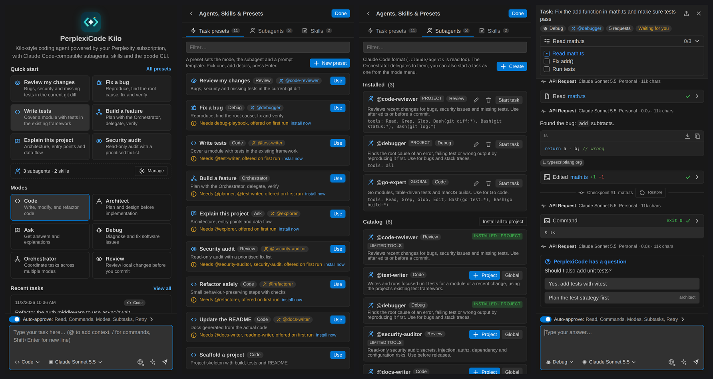

<table>
  <tr>
    <td align="center">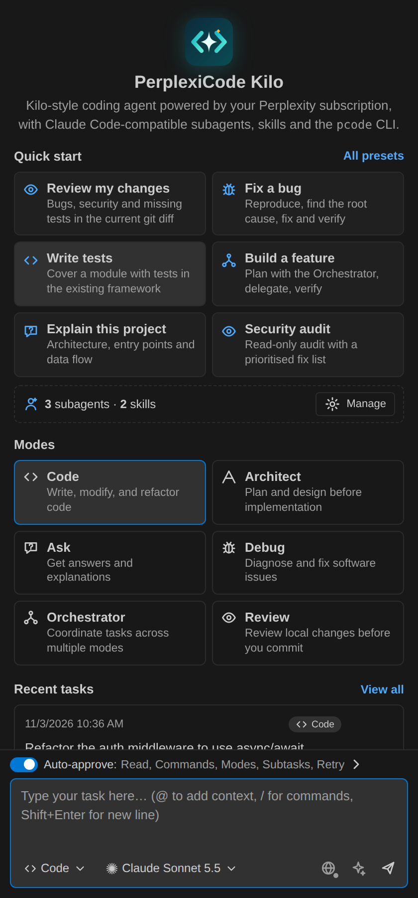<br /><sub>Welcome screen with Quick start presets</sub></td>
    <td align="center">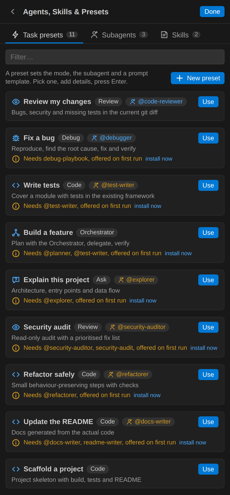<br /><sub>Task presets: mode + subagent + prompt</sub></td>
    <td align="center">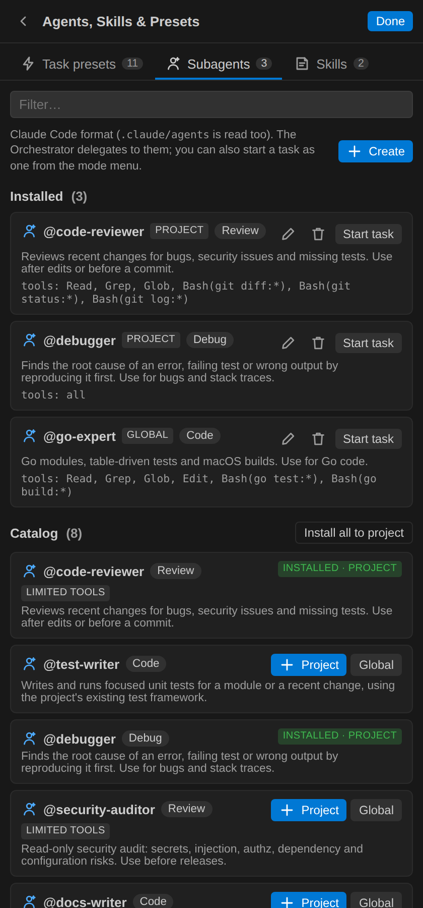<br /><sub>Installed subagents and the catalog</sub></td>
  </tr>
  <tr>
    <td align="center">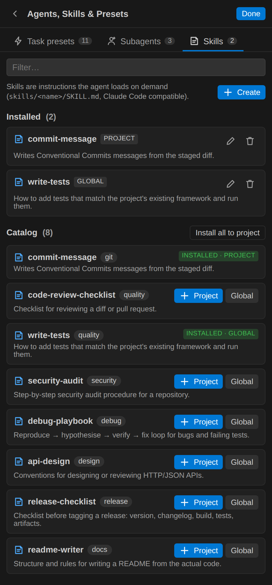<br /><sub>Skills (<code>SKILL.md</code>, Claude Code compatible)</sub></td>
    <td align="center">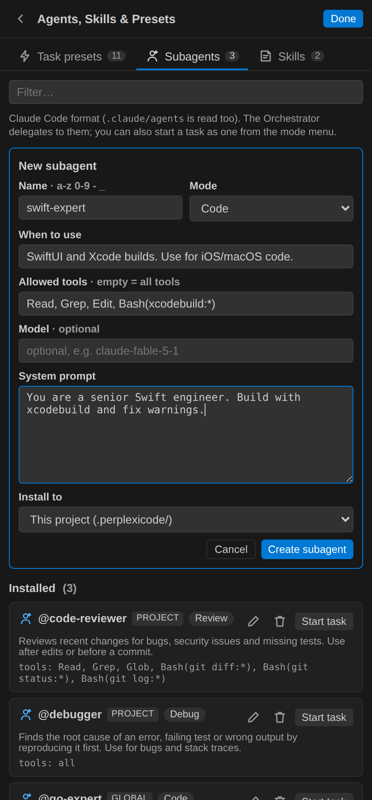<br /><sub>Create your own subagent</sub></td>
    <td align="center">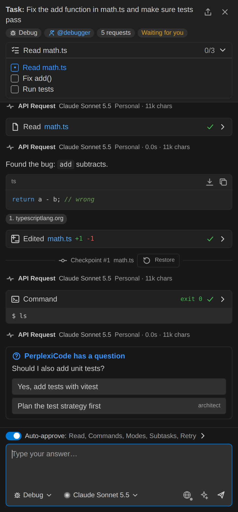<br /><sub>Task run by <code>@debugger</code></sub></td>
  </tr>
  <tr>
    <td align="center">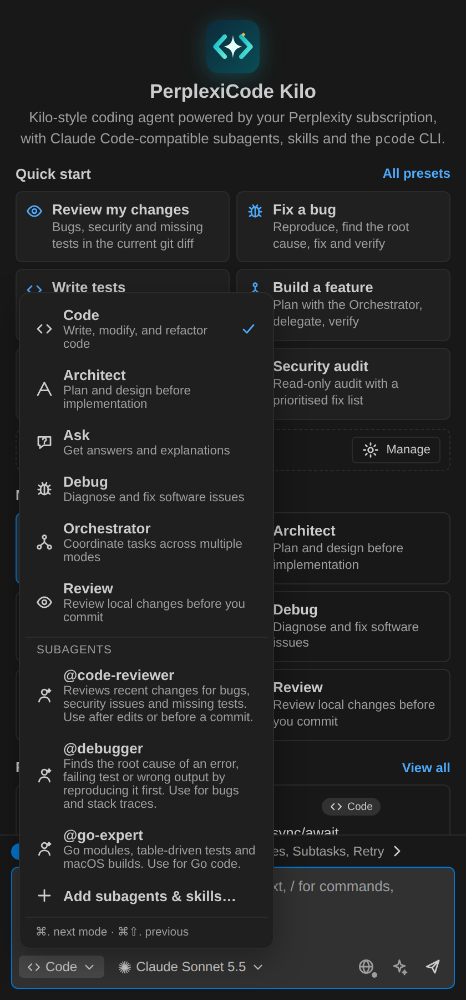<br /><sub>Modes and subagents (<code>Cmd+.</code> cycles modes)</sub></td>
    <td align="center">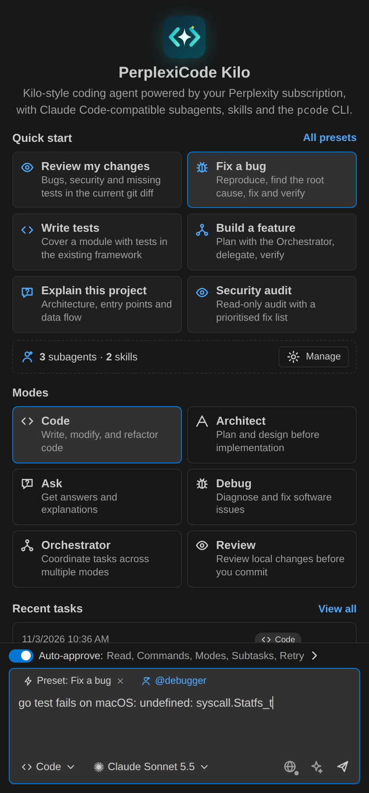<br /><sub>Preset chip in the composer</sub></td>
    <td align="center">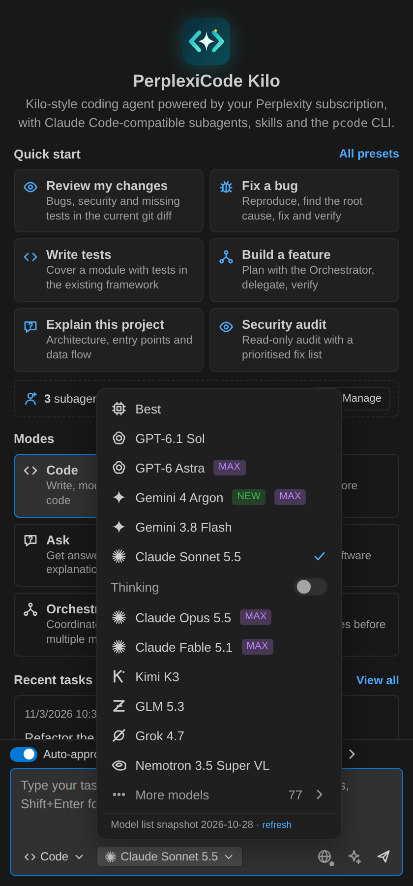<br /><sub>Model picker with Max badges and Thinking toggle</sub></td>
  </tr>
  <tr>
    <td align="center">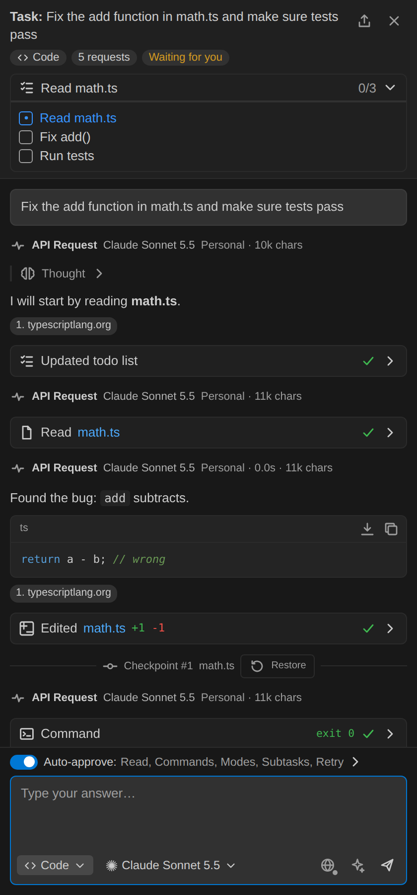<br /><sub>Agent task with todo list, tools and checkpoints</sub></td>
    <td align="center">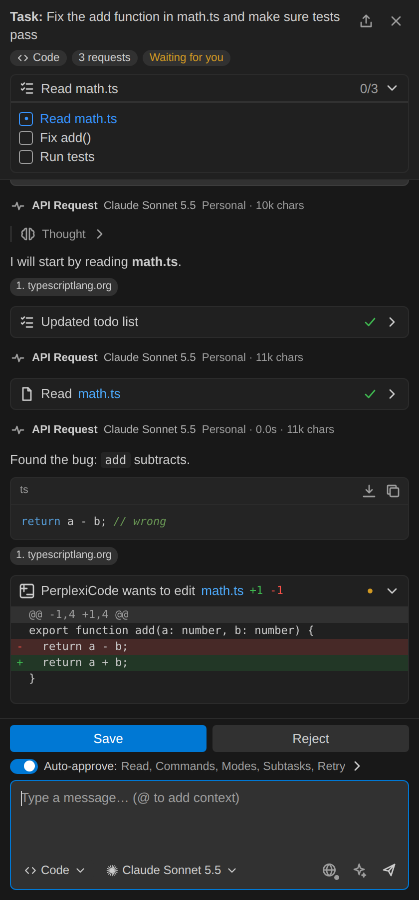<br /><sub>Edit approval with inline diff</sub></td>
    <td align="center">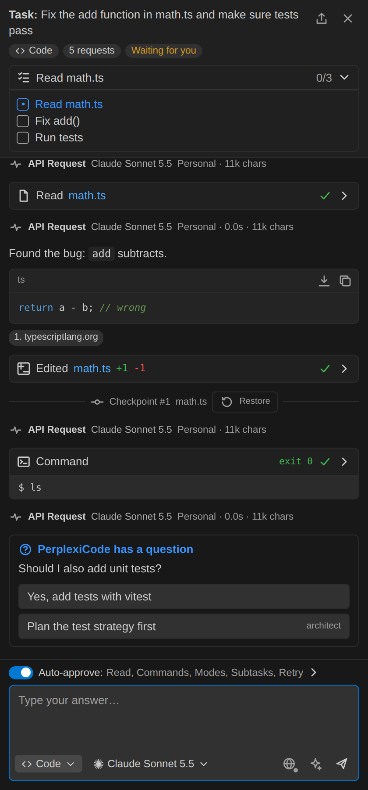<br /><sub>Commands and follow-up questions</sub></td>
  </tr>
  <tr>
    <td align="center">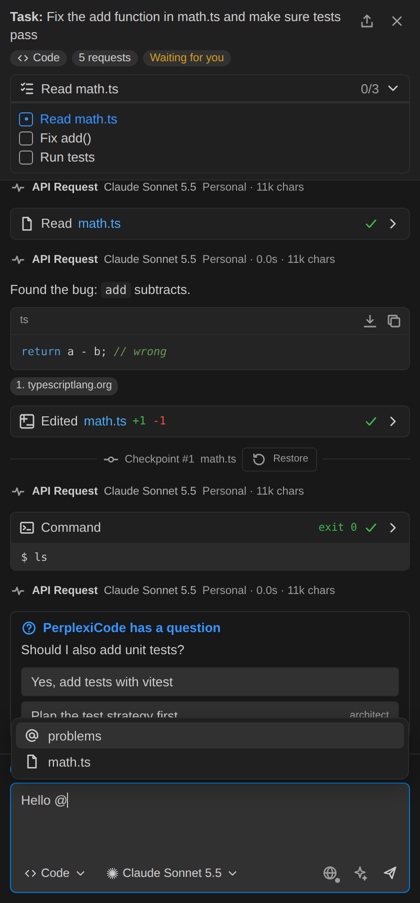<br /><sub><code>@</code> mentions</sub></td>
    <td align="center">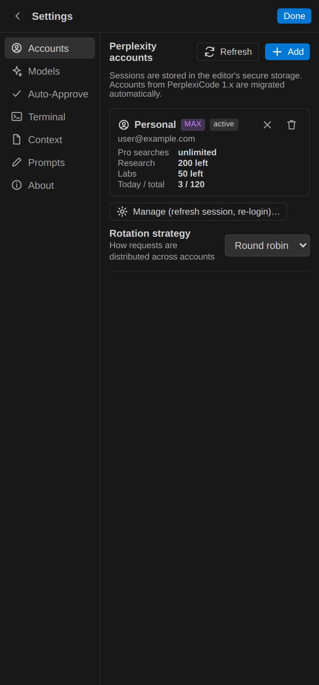<br /><sub>Accounts, models, auto-approve, terminal, context, prompts</sub></td>
    <td align="center">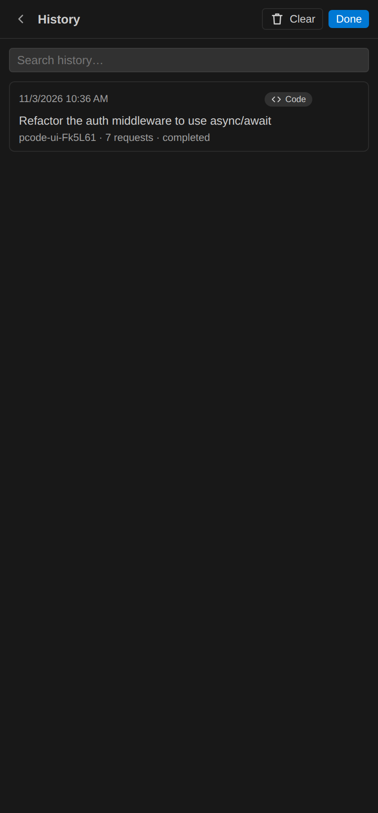<br /><sub>Task history</sub></td>
  </tr>
</table>

<sub>Screenshots are rendered from the test fixture (`npm run test:webview`) with sample data.</sub>

</details>

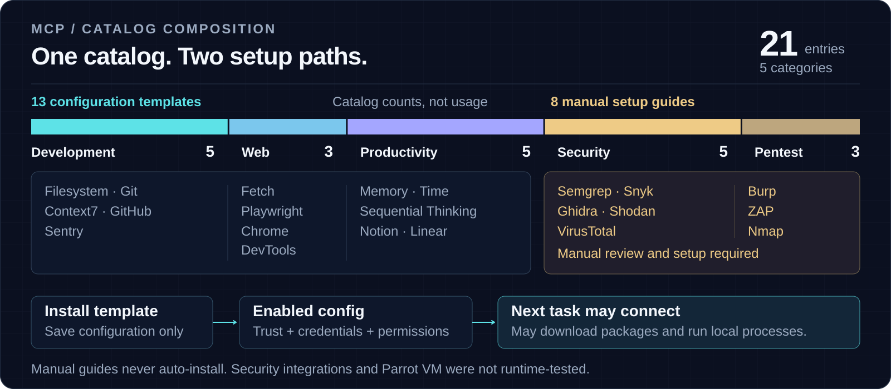

<a id="34-mcp-catalog-security-and-parrot-os"></a>
<details>
<summary><strong>MCP catalog · 3.4</strong> · Enabled servers may run on the next task; Parrot OS is not runtime-tested</summary>

### MCP catalog, security and Parrot OS

The MCP tab now includes a curated catalog with searchable Development, Web, Productivity, Security and Pentest categories. Each entry links to upstream documentation and explains its runtime requirements, use case, setup caveats and source-check date. This is a selection of useful integrations, not a measured popularity ranking or a security audit.

- **Configuration templates:** Project / Global buttons collect parameters in native IDE prompts. Tokens are entered in password inputs and stored in VS Code SecretStorage; JSON files contain only `${ENV_VAR}` references. The binding includes the exact config and file, so another server or an edited command/URL cannot silently reuse the saved token. CLI runs supply their own environment variables, not IDE credentials.
- **Setup guides:** Native tools, plugins and integrations requiring additional setup are explicitly labelled Setup guide. They are not presented as one-click installations.
- **Security / Pentest:** Dedicated entries describe code and dependency checks, threat intelligence, web testing, network inventory and reverse engineering. Read the [Security MCP and Parrot OS guide](docs/MCP-SECURITY-PARROT.md) for prerequisites, exact upstream examples and where each tool is useful.
- **No execution during installation:** Installing a catalog template saves an enabled config only. It does not download software, start a process, scan a target or add permission rules. Your next task can connect enabled servers and download/run the declared npm/uv package, subject to the existing workspace trust guard for project stdio servers. Existing server names are not overwritten.

```bash
pcode mcp catalog                   # all entries, requirements and documentation
pcode mcp catalog security
pcode mcp catalog pentest
pcode mcp install context7 -s user  # adds configuration only
pcode mcp install filesystem --set DIRECTORY=/absolute/path/to/allowed/files
```

Catalog tokens must come from the environment, never `--set`, `--env` or `--header` on `mcp install`. Use the manual `pcode mcp add` command after completing a native tool's setup guide. Security tools should run as an ordinary user in a lab or on explicitly authorised targets; Parrot OS compatibility is documented as prerequisites and upstream Linux support, not a claim of VM testing.

[`.env.example`](.env.example) lists the supported token variable names. PerplexiCode does not automatically load dotenv files: export the needed variables in your CLI environment, or use the IDE's native password prompts. Populated `.env` files are excluded from Git and VSIX packaging.

</details>

<a id="33-mcp-servers-and-compute-modes"></a>
<a id="mcp-servers"></a>
<a id="compute-modes"></a>
<a id="new-tools-in-33"></a>
<details>
<summary><strong>MCP & compute · 3.3</strong> · Configuration, trust, permissions and execution modes</summary>

### MCP servers

PerplexiCode speaks the [Model Context Protocol](https://modelcontextprotocol.io) the way Claude Code does, so an existing `.mcp.json` or `~/.claude.json` works without changes.

| | |
| --- | --- |
| **Config files** | `~/.claude.json` (root and `projects[<folder>]`), `~/.claude/.mcp.json`, `~/.perplexicode/mcp.json`, the `mcpServers` block of any settings file, `<project>/.mcp.json`, `.claude/.mcp.json`, `.perplexicode/mcp.json`, `.mcp.local.json` and `*.local.json`. Later files override earlier ones by server name. `${VAR}` and `${VAR:-default}` are expanded in `command`, `args`, `env`, `url` and `headers`. |
| **Transports** | `stdio` (`command` + `args`), `http` (Streamable HTTP) and `sse`, with custom `headers`. Server-initiated `ping` and `roots/list` are answered and `tools/list_changed` refreshes the tool list. |
| **Trust** | stdio servers from the project or `.local.json` start only in a trusted workspace (Workspace Trust in VS Code, `--trust-project` in the CLI). User-level and HTTP servers always start. Untrusted servers are listed with the reason. |
| **Agent tools** | `use_mcp_tool`, `access_mcp_resource`, `list_mcp_resources`, or a direct `<mcp__server__tool>{"arg": 1}</mcp__server__tool>` call. The system prompt lists tools, resources and prompts only while a server is connected. |
| **Permissions** | Rules `mcp__server__tool`, `mcp__server__*`, `mcp__server`, `mcp` and `mcp(server)` in `allow` / `ask` / `deny`. The Auto-approve popover has an **MCP** toggle (`autoApprove.mcp`). Plan mode blocks MCP tool calls unless a rule allows them. Hooks see the tool as `mcp__server__tool`, like in Claude Code. |
| **VS Code** | **Library → MCP** tab (status, tools, resources, add / remove / reconnect, open the config file), `/mcp` in the composer, **PerplexiCode: MCP: Reconnect Servers**, settings `perplexicodeKilo.mcp.enabled` and `perplexicodeKilo.mcp.extraConfigs`. |
| **CLI** | `pcode mcp list \| add \| remove \| get \| test`, `--mcp-config <file\|json>` (repeatable), `--strict-mcp-config`, `--no-mcp`, REPL `/mcp [reconnect [name]]`. `pcode doctor` shows the servers. |

```bash
# Supply GITHUB_PERSONAL_ACCESS_TOKEN through your environment before connecting.
pcode mcp install github -s user    # official remote service; saves enabled config only
pcode mcp add docs -t http -H 'Authorization: Bearer ${DOCS_TOKEN}' -- https://mcp.example.com/mcp
pcode mcp list                       # name, type, scope, enabled/untrusted, target, config file
pcode mcp get github                 # connects and lists tools and resources
pcode -p "list open issues labelled bug" --allowedTools "mcp__github__list_issues"
pcode -p "summarise README" --mcp-config ./ci-mcp.json --strict-mcp-config
```

```jsonc
// .mcp.json (project) — the Claude Code format
{
  "mcpServers": {
    "filesystem": { "command": "npx", "args": ["-y", "@modelcontextprotocol/server-filesystem", "."] },
    "docs": { "type": "http", "url": "https://mcp.example.com/mcp", "headers": { "Authorization": "Bearer ${DOCS_TOKEN}" } }
  }
}
```

### Compute modes

A compute mode decides how Perplexity runs the request; the model picker still decides which model answers in Search mode.

| Mode | What runs | Plan |
| --- | --- | :---: |
| `search` (default) | Standard query with the selected model, optional Thinking and web search | Free |
| `light` · `standard` · `high` · `ultra` | Perplexity Computer harness with GPT-6.1 Sol · Claude Opus 5.5 · GPT-6 Astra · Claude Fable 5.1 (Ultra uses high effort) | **Max** |
| `computer` | Computer (ASI) with the ASI variant of the selected model | **Max** |
| `research` | Deep Research | Pro |
| `agentic_research` | Agentic research synthesis | **Max** |
| `labs` | Labs / Studio for files, apps and structured artifacts | Pro |

If a mode is not available for your accounts or its quota is exhausted, the request falls back along a chain (Computer harness → Comet browser agent → Search with the closest chat model; Deep Research → Best) and the task log says which mode was actually used.

- **VS Code**: the compute pill next to the model picker, **PerplexiCode: Select Compute Mode**, setting `perplexicodeKilo.computeMode` (default `search`); the status bar shows the active mode.
- **CLI**: `pcode --compute ultra -p "…"`, REPL `/compute [mode]`, `pcode models` lists the modes, and `computeMode` in `.perplexicode/settings.json` sets a per-project default.

### Additional tools

`glob_files` (gitignore-style patterns inside the workspace), `search_and_replace` (literal or regex, optional line range) and `web_fetch` (HTTP(S) GET with redirects, size limit and HTML → text; rules `WebFetch(domain:docs.example.com)` and the **Web** auto-approve toggle).

</details>

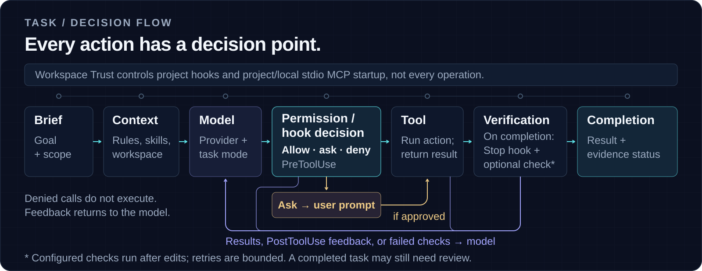

<a id="30-headless-core--pcode-cli"></a>
<details>
<summary><strong>Headless core & pcode CLI</strong> · Permissions, hooks, verification and resumable sessions</summary>

The extension and a terminal CLI share one agent core, so you get Kilo Code in the editor and Claude Code in the terminal from one install.

| | |
| --- | --- |
| **`pcode` CLI** | REPL with diff approvals and slash commands (`/mode`, `/permissions`, `/compact`, `/resume` …). Headless `pcode -p "…"` with `--output-format text\|json\|stream-json` for scripts and CI. |
| **Claude Code compatible config** | Reads `.claude/settings.json` (permissions and hooks), `.claude/agents/*.md`, skills and `CLAUDE.md`. Your existing `.claude/` folder works as is, next to `.perplexicode/`. |
| **Permissions** | `allow` / `ask` / `deny` rules such as `Bash(npm test:*)` and `Edit(src/**)`. Modes `default`, `acceptEdits`, `plan` and `bypassPermissions`. Built-in protection for `.env`, keys and `.ssh`, including through symlinks and `cat .env`. |
| **Hooks** | `PreToolUse`, `PostToolUse`, `UserPromptSubmit`, `Stop`, `SubagentStop`, `SessionStart`, `SessionEnd`. Exit code 2 blocks the action. JSON decisions are supported. Project hooks run only in trusted folders. |
| **Verify before done** | `verify.command` (for example `npm test`) runs before the task can finish, and a failing check sends the agent back to fix it. Each task ends with a status: verified, needs review, failed, blocked or no changes. |
| **Subagents** | `new_task` can delegate to your own agents. Each one has its own prompt, model and tool list, and the tool list is enforced. |
| **Resume anywhere** | Every IDE or CLI task writes a journal to `~/.perplexicode/sessions`. `pcode -c` continues the last one. Commands that were cut off by a crash are flagged, and the agent checks the real state before re-running them. |
| **Fewer round-trips** | Up to 5 read-only tool calls from one answer run in one step. |
| **Two transports** | Your Perplexity Pro/Max web session, with account rotation (shared with the extension through **PerplexiCode: Share Accounts with CLI** or `pcode login`), or any OpenAI-compatible endpoint (`--provider openai`: Ollama, LM Studio, vLLM). |

```bash
git clone https://github.com/MRX7999/PerplexiCode-Kilo && cd PerplexiCode-Kilo
npm ci && npm run build && npm link          # puts `pcode` on PATH
pcode login                                  # paste the Cookie header (hidden input) or use --browser
pcode doctor
pcode -p "fix the failing test" --permission-mode acceptEdits --allowedTools "Bash(npm test:*)"
```

See [docs/CORE-3.0.md](docs/CORE-3.0.md) for the full reference and [examples/claude-code-compat](examples/claude-code-compat) for a working configuration.

</details>

<a id="models"></a>
<details>
<summary><strong>Models</strong> · Account discovery, fallback catalog and subscription handling</summary>

The model list matches the current Perplexity picker. It is loaded live from your account's model config, with a bundled snapshot (2026-10-28, 89 models) as a fallback.

| Model | Provider | Plan | Thinking |
| --- | --- | :---: | :---: |
| Best | Perplexity | Free | — |
| GPT-6.1 Sol | OpenAI | Pro | ✓ |
| GPT-6 Astra | OpenAI | **Max** | ✓ |
| Gemini 4 Argon `NEW` | Google | **Max** | ✓ |
| Gemini 3.8 Flash | Google | Pro | ✓ |
| Claude Sonnet 5.5 | Anthropic | Pro | ✓ |
| Claude Opus 5.5 | Anthropic | **Max** | ✓ |
| Claude Fable 5.1 | Anthropic | **Max** | ✓ |
| Kimi K3 | Moonshot AI | Pro | built-in |
| GLM 5.3 | Z.ai | Pro | built-in |
| Grok 4.7 | xAI | Pro | ✓ |
| Nemotron 3.5 Super VL | NVIDIA | Pro | — |
| **More models** (77) | Anthropic, OpenAI, Google, xAI, Perplexity Sonar… | Pro / Max | per model |

Max models unlock automatically for Max accounts. If a Max model is picked on a Pro-only account pool, the request falls back to **Best**. Override plan detection with `perplexicodeKilo.subscriptionPlan` if needed, and use **PerplexiCode: Refresh Models and Quotas** after Perplexity adds new models.

</details>

<a id="commands-and-shortcuts"></a>
<details>
<summary><strong>Commands & shortcuts</strong> · Editor actions and keyboard reference</summary>

| Command | macOS | Windows / Linux |
| --- | --- | --- |
| PerplexiCode: Open Agent | `Cmd+Alt+K` | `Ctrl+Alt+K` |
| PerplexiCode: New Task | `Cmd+Alt+N` | `Ctrl+Alt+N` |
| PerplexiCode: Switch to Next Mode | `Cmd+.` | `Ctrl+.` |
| PerplexiCode: Add Selection to Chat | `Cmd+Shift+I` | `Ctrl+Shift+I` |
| PerplexiCode: Add to Context | `Cmd+K Cmd+A` | `Ctrl+K Ctrl+A` |
| PerplexiCode: Explain / Fix / Improve Code | context menu, lightbulb | context menu, lightbulb |
| PerplexiCode: Explain Current File | Command Palette | Command Palette |
| PerplexiCode: Add Terminal Selection to Context | terminal context menu | terminal context menu |
| PerplexiCode: Generate Commit Message | Source Control title bar | Source Control title bar |
| PerplexiCode: Select Model / Mode / Compute Mode | status bar | status bar |
| PerplexiCode: MCP: Reconnect Servers | Command Palette | Command Palette |
| PerplexiCode: Task History · Settings · Open in Editor Tab | view title bar | view title bar |
| PerplexiCode: Add / Manage Accounts · Set Account Rotation Strategy · Refresh Models and Quotas | Command Palette | Command Palette |

</details>

<a id="settings"></a>
<details>
<summary><strong>Settings</strong> · All defaults, approval controls and context limits</summary>

| Setting | Default | Description |
| --- | --- | --- |
| `perplexicodeKilo.defaultModel` | `turbo` (Best) | Model for new tasks. |
| `perplexicodeKilo.subscriptionPlan` | `auto` | Force `pro` or `max` when detection is wrong. |
| `perplexicodeKilo.computeMode` | `search` | Default compute mode: `search`, `light`, `standard`, `high`, `ultra`, `research`, `agentic_research`, `labs`. |
| `perplexicodeKilo.mcp.enabled` | `true` | Connect to configured MCP servers. |
| `perplexicodeKilo.mcp.extraConfigs` | `[]` | Extra MCP config files or inline JSON, like `pcode --mcp-config`. |
| `perplexicodeKilo.agent.autoApprove.enabled` | `true` | Master switch for auto-approval. |
| `perplexicodeKilo.agent.autoApprove.read` | `true` | Reading, listing and searching inside the workspace. |
| `perplexicodeKilo.agent.autoApprove.readOutsideWorkspace` | `false` | Reads outside the workspace. |
| `perplexicodeKilo.agent.autoApprove.write` | `false` | Creating and editing files. |
| `perplexicodeKilo.agent.autoApprove.execute` | `false` | Commands matching `allowedCommands`. |
| `perplexicodeKilo.agent.autoApprove.modeSwitch` | `true` | Mode switches requested by the agent. |
| `perplexicodeKilo.agent.autoApprove.subtasks` | `true` | Orchestrator subtasks. |
| `perplexicodeKilo.agent.autoApprove.todo` | `true` | Todo list updates. |
| `perplexicodeKilo.agent.autoApprove.retry` | `true` | Retry failed Perplexity requests. |
| `perplexicodeKilo.agent.autoApprove.mcp` | `false` | MCP tool calls and resource reads (permission rules still apply). |
| `perplexicodeKilo.agent.autoApprove.web` | `false` | `web_fetch` requests (`WebFetch(domain:…)` rules still apply). |
| `perplexicodeKilo.agent.allowedCommands` | `npm test`, `npm run`, `git status`, `git diff`, `git log`, `ls`, `cat`, `pwd` | Command prefixes that may run without approval (`*` = all). |
| `perplexicodeKilo.agent.deniedCommands` | `rm -rf`, `sudo`, `git push --force` | Prefixes that always need approval. |
| `perplexicodeKilo.agent.maxRequestsPerTask` | `40` | Ask before continuing after this many requests. |
| `perplexicodeKilo.agent.maxReadFileLines` | `500` | Lines per `read_file` call. |
| `perplexicodeKilo.agent.commandTimeoutSeconds` | `120` | Command timeout, `0` = none. |
| `perplexicodeKilo.agent.terminalOutputLineLimit` | `300` | Terminal lines sent to the model. |
| `perplexicodeKilo.agent.webSearch` | `auto` | Whether Perplexity may search the web for agent requests. |
| `perplexicodeKilo.agent.contextStrategy` | `auto` | Thread follow-ups or full self-contained prompts. |
| `perplexicodeKilo.agent.maxPromptChars` | `60000` | Prompt size limit; older turns are condensed. |
| `perplexicodeKilo.agent.language` | `auto` | Reply language, e.g. `en`, `ru`. |
| `perplexicodeKilo.agent.customInstructions` | — | Instructions added to every mode. |
| `perplexicodeKilo.agent.modeInstructions` | `{}` | Per-mode instructions keyed by mode slug. |
| `perplexicodeKilo.agent.diffEnabled` | `true` | Use `apply_diff` instead of full rewrites. |
| `perplexicodeKilo.agent.includeFileListOnStart` | `true` | Send the workspace file list with the first request. |
| `perplexicodeKilo.agent.revealEditedFiles` | `true` | Open files after the agent edits them. |
| `perplexicodeKilo.excludePatterns` | `node_modules`, `.git`, `dist`, `out`, `.next` | Globs excluded from context. |

</details>

<a id="build-from-source"></a>
<a id="project-layout"></a>
<details>
<summary><strong>Build & project layout</strong> · Local checks, packaging and release workflow</summary>

Requirements: [Node.js](https://nodejs.org/) 20+ and npm.

```bash
git clone https://github.com/MRX7999/PerplexiCode-Kilo.git
cd PerplexiCode-Kilo
npm ci
npm run lint                                   # extension + webview type check
npm test                                       # parser, diff engine, tools, models, agent loop, transport
npx vsce package --out perplexicode-kilo.vsix  # build the VSIX
```

`npm run test:webview` renders the webview in headless Chromium and saves screenshots to `out/test/` (needs a [Playwright](https://playwright.dev/) Chromium in `~/.cache/ms-playwright`).

Releases are built by [GitHub Actions](.github/workflows/release.yml): pushing a `vX.Y.Z` tag runs the tests, packages the VSIX and attaches it to a GitHub release.

### Project layout

```text
src/
  extension.ts          activation, commands, code actions, webview providers
  agent/                agent loop, modes, prompts, tool parser and executor, diff engine, transport, task store
  api/                  Perplexity client, model catalog, bundled model config, quotas, account rotation
  providers/            login flows
  storage/              account manager (SecretStorage)
  ui/                   status bar
webview-ui/agent/       chat UI (TypeScript + CSS, bundled with esbuild)
test/                   unit and agent tests, webview render harness
scripts/                install.sh, install.ps1
```

</details>

<a id="troubleshooting"></a>
<details>
<summary><strong>Troubleshooting</strong> · Authentication, installation and task recovery</summary>

| Problem | Fix |
| --- | --- |
| Max models are locked on a Max account | Run **Refresh Models and Quotas**, or set `perplexicodeKilo.subscriptionPlan` to `max`. |
| `401` / session expired | **Manage Accounts** → refresh session, or add the account again. |
| The CLI says `NOT registered` | Harmless Antigravity warning; check `--list-extensions --show-versions`. |
| Install script cannot find the editor | Pass `--vsix` with a downloaded file, or use **Install from VSIX…**. |
| Agent stops after many steps | Raise `perplexicodeKilo.agent.maxRequestsPerTask`. |
| `Unable to write to User Settings … is not a registered configuration` | The extension was updated while the window stayed open. Run **Developer: Reload Window**. Since 2.1.0 the change is saved anyway and moved into settings after the reload. |
| Anything else | Open **Output → PerplexiCode** and attach the log to an [issue](https://github.com/MRX7999/PerplexiCode-Kilo/issues). |

</details>

<a id="credits"></a>
<a id="disclaimer"></a>
<a id="license"></a>
<details>
<summary><strong>Credits, disclaimer & license</strong> · Unofficial community project, subscription limits and MIT terms</summary>

### Credits

- Original extension: [yuki-20/PerplexiCode](https://github.com/yuki-20/PerplexiCode) (MIT).
- Agent design, modes and tool protocol follow [Kilo Code](https://github.com/Kilo-Org/kilocode), itself based on [Roo Code](https://github.com/RooCodeInc/Roo-Code) and [Cline](https://github.com/cline/cline).

### Disclaimer

PerplexiCode is an unofficial community project and is not affiliated with or endorsed by Perplexity AI, Kilo Code or Google. It uses your own Perplexity web session; usage counts against your subscription limits and is subject to the [Perplexity Terms of Service](https://www.perplexity.ai/hub/legal/terms-of-service).

### License

[MIT](LICENSE). Original work © yuki-20; PerplexiCode Kilo changes © MRX7999.

</details>
